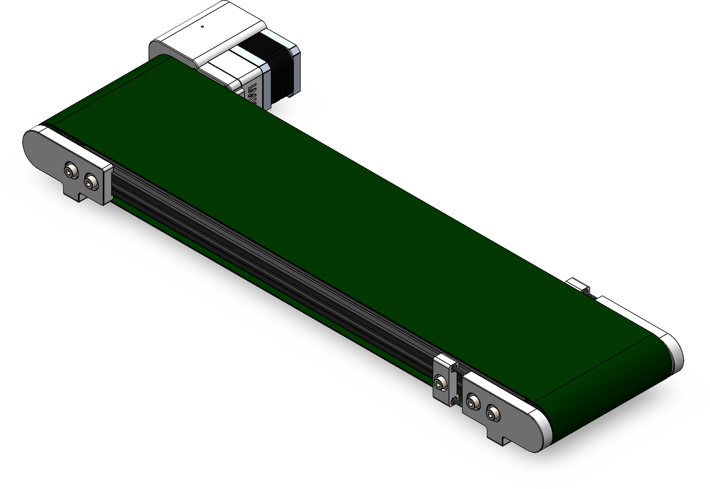
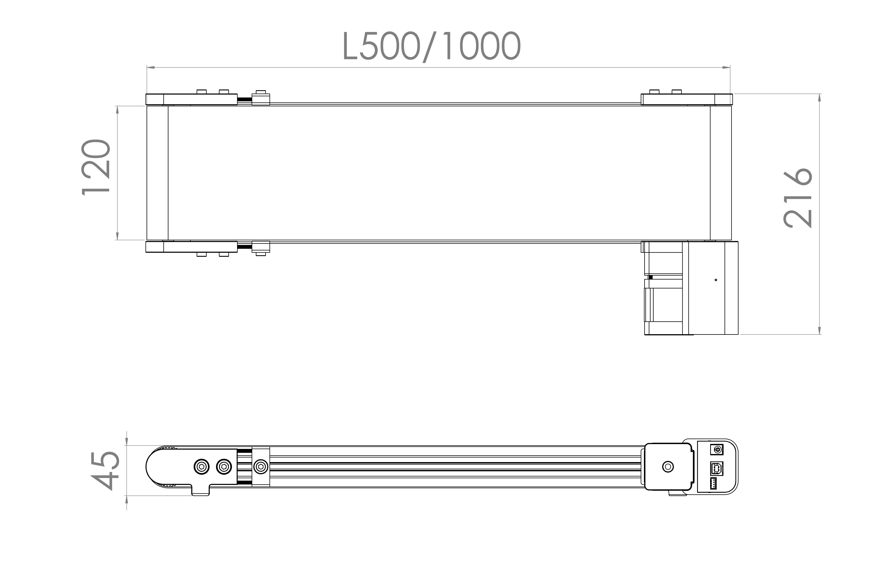

# Short Conveyor Specifications

<!-- Preserve the published title fragment. -->

## Introduction

The Short Conveyor is mainly used in small-scale projects and experimental setups involving Delta X 1 and Delta X 2 robots. Its compact design makes it easy to deploy and integrate into various systems.

## System Components

The Short Conveyor integrates a range of essential components tailored to its specific design:

| Component                  | Material               |
| -------------------------- | -----------------      |
| Frame                      | 2020 Alumium profiles  |
| Rollers                    | 3D printed             |
| Motor                      | NEMA 17 Stepper Motor  |
| Gearbox                    | 1:3 GT2 Belt Drive gearbox |
| Belt                       | PVC                    |
| Control Board              | ATmega328P MCU         |
| Power Supply               | 12VDC/3A               |

## Dimensions

## Conveyor Specifications

| Parameter                  | Specifications         |
| -------------------------- | -----------------      |
| Length                     | 500/1000 mm            |
| Width                      | 120 mm                 |
| Motor                      | NEMA 17 Stepper Motor  |
| Speed Adjustment           | G-code / Potentiometer |
| Frame Material             | 2020 Aluminum          |

## Conveyor Features

| Feature                    | Description            |
| -------------------------- | -----------------      |
| Max Speed                  | 200 mm/s               |
| Positioning Accuracy       | ±0.2 mm                |
| Power Supply               | 12VDC/3A               |

## Control Options

The Short Conveyor offers flexible control methods:

- **G-Code Control:** Use G-Code commands for precise speed adjustments.
- **Variable Speed Control:** Adjust conveyor speed manually using a potentiometer.

!!! note "Note"
    See the [Short Conveyor G-code reference](../../../gcodes/gc_short_conveyor.md) for serial setup, control modes, and commands M310–M313.

## Applications

The Short Conveyor is exceptionally well-suited for diverse applications, including:

- Experimental projects
- Small-scale lab endeavors
- Integration with robotic arms such as delta robots

## Contact Us

- Store: [https://deltaxstore.com](https://deltaxstore.com)
- Website: [https://www.deltaxrobot.com](https://www.deltaxrobot.com)
- Email: [deltaxrobot@gmail.com](mailto:deltaxrobot@gmail.com)
- Phone: +84 38 875 2005
