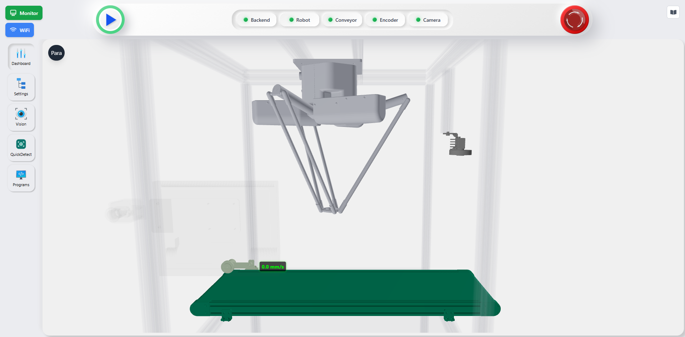
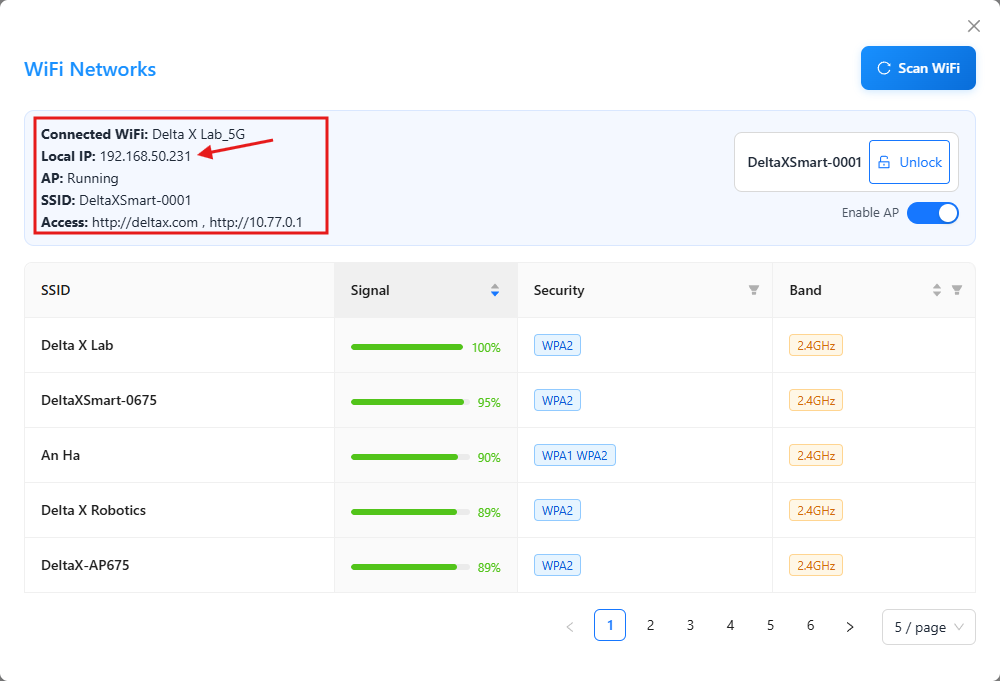
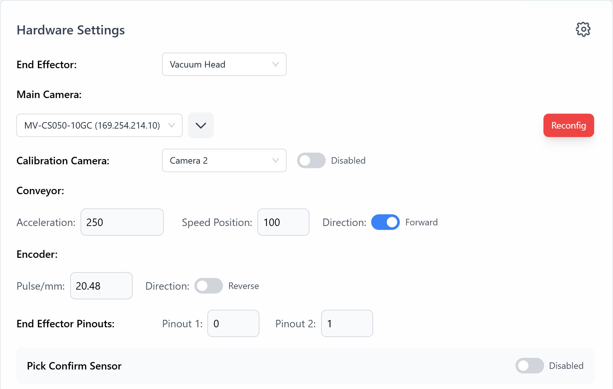
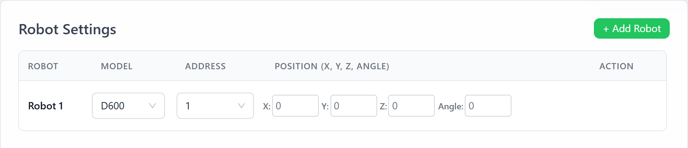

# DeltaXStudio — System Setup

Start by connecting the robot to your network and checking its hardware. Then continue with [Calibration](deltaxstudio/calibration.md), [Vision](deltaxstudio/vision.md), and [Pick & Place](deltaxstudio/pick_and_place.md).

For custom programs, use the separate [Blockly guide](deltaxstudio/blockly.md).

## Connect to the robot for the first time

Power on the robot and its controller, then wait for the robot's Wi-Fi access point (AP) to appear. On your computer or tablet, open the Wi-Fi list and join the robot's AP. Its name normally follows DeltaXSmart-xxxx. The default password is `12345678`; use the configured password if it has been changed.

Stay connected even if your device reports that this network has no Internet access. Open http://deltax.com in your browser. DeltaXStudio should appear as shown below.

## Connect the robot to your Wi-Fi

Open WiFi at the upper left of DeltaXStudio, then use Scan WiFi to find and select your network. Enter your Wi-Fi password and click Connect.

Wait for the connection to succeed. At the top of the window, check that Connected WiFi shows your network name and Local IP shows an IP address. Write down Local IP before switching your computer to another network.

In this screenshot, the robot has joined Delta X Lab_5G and its Local IP is `192.168.50.231`. Your network name and IP address will be different. Use Local IP for access through your Wi-Fi; the address under Access belongs to the robot's AP.

## Open DeltaXStudio through your Wi-Fi

Connect your computer or tablet to the same Wi-Fi network as the robot. In your browser, enter `http://<Local IP>:3000`, replacing `<Local IP>` with the address you wrote down. For the screenshot above, the address is `http://192.168.50.231:3000`.

Confirm that DeltaXStudio opens. You can now access the robot through your own network.

The standard web port is `3000`; use the port supplied with your installation if it differs. After switching to your Wi-Fi, use the robot's IP address instead of `deltax.com`.

Once IP access works, you can turn off Enable AP in the WiFi window if you no longer need the robot's hotspot.

## Find the main controls

Once connected, use the navigation to work through the setup:

| Area | Use |
| --- | --- |
| Dashboard | View the robot, camera, conveyor, and operating status. |
| Settings → System | Configure the installed hardware, robot, vision, and startup behavior. |
| Settings → Calibration | Run the guided camera and robot calibration. |
| Settings → Parameters | Set pick and place positions, motion parameters, and object selections. |
| Vision | Capture images for labeling and training in DeltaXHub, or prepare template images for detection. |
| Programs | Create, check, save, and run Blockly tasks. |

Keep Auto Start disabled while setting up the system. After changing settings, click Save and wait for confirmation. When a configuration change requires a restart, stop the running task first, then use Settings → System → System Control → Reset and wait for the interface to reconnect.

## Check the installed hardware

Open Settings → System and review Hardware Settings. Enable the devices actually installed, including the main camera and, for a conveyor setup, the conveyor and encoder.

<figure class="studio-figure" markdown="1">

<figcaption>Check the installed camera, encoder, conveyor, and tool outputs. The selected devices and numeric values are examples; use the hardware fitted to your installation.</figcaption>
</figure>

In Robot Settings, check the robot model and its detected address. The robot address identifies the robot controller; it is separate from the Wi-Fi Local IP used to open the web page. Check the end-effector type and output configuration for your vacuum tool or gripper.

<figure class="studio-figure" markdown="1">

<figcaption>Verify the model and controller address for each robot. This address is separate from the web interface IP.</figcaption>
</figure>

Save the settings and return to Dashboard. Confirm that the intended robot is connected and that the camera produces a current image. For a conveyor system, confirm that encoder readings respond to conveyor movement before starting calibration.

A working web page confirms access to DeltaXStudio; check the device status separately before sending robot commands. If an advanced setting is hidden, switch the settings view from Basic to Advanced.

## Ready for calibration

Continue when the intended robot and camera respond correctly, and the encoder responds to conveyor movement if your setup uses tracking. Then [calibrate the camera and robot coordinates](deltaxstudio/calibration.md).

## If you cannot connect

| Problem | What to check |
| --- | --- |
| The robot AP is missing | Check power and wait for the controller to start, then refresh your device's Wi-Fi list. |
| `deltax.com` does not open | Make sure you are connected to the robot's AP and enter `http://deltax.com` explicitly. Stay on the AP if your device warns about no Internet access. |
| The robot cannot join your Wi-Fi | Check the selected network and password, move within signal range, and scan again. |
| The AP disconnects during setup | Join your own Wi-Fi and find the robot controller's IP in the router's connected-device list. |
| The IP address does not open | Confirm that your computer and robot are on the same network. Check the current Local IP and include the web port, normally `3000`. |
| A previously working bookmark stops opening | Your router may have assigned a new IP address. Check the controller's current address in the router, or through the robot AP if it is available. |
