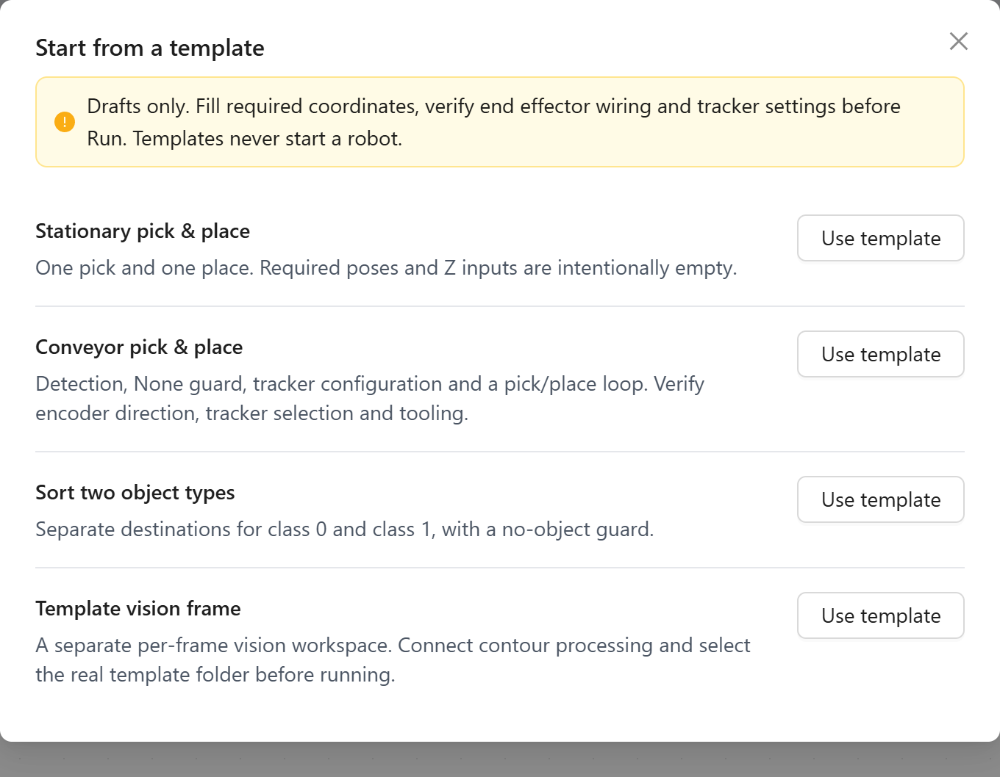
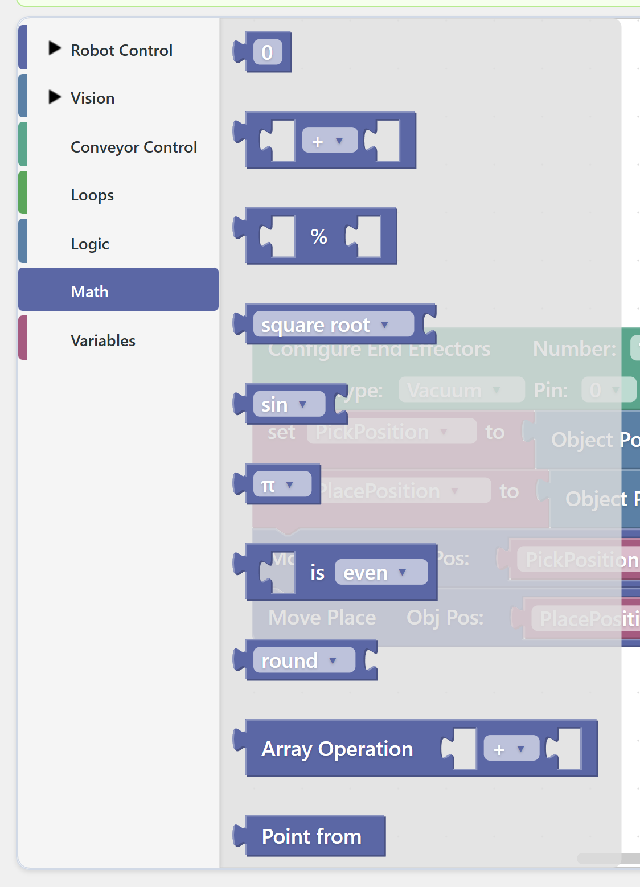
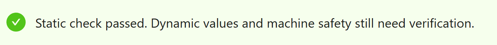
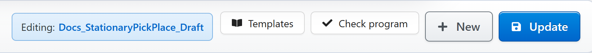
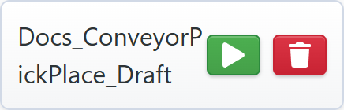
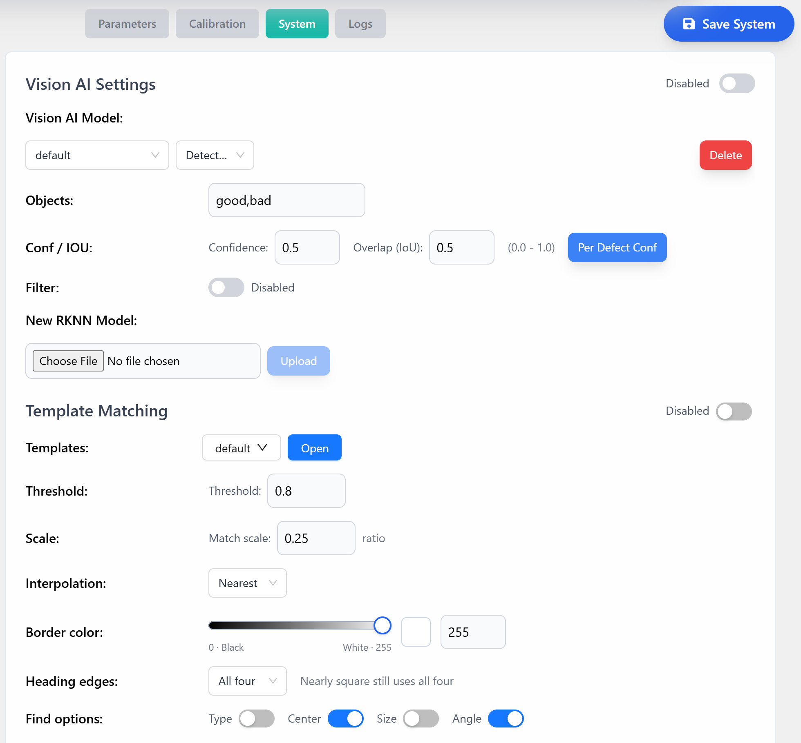
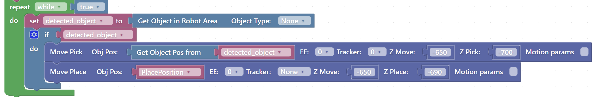

# DeltaXStudio — Blockly Programming

Use Programs to build a task by connecting blocks. A task can control robot movement, operate the end effector, process camera images, or combine detection with picking.

Start here to learn the editor: create a program, connect its blocks, check and save it, then run a test. Connect the robot and check its tool using [System Setup](../deltaxstudio.md) before testing movement. Camera-based examples list their own Calibration and Vision requirements.

For built-in picking, follow [Pick & Place](pick_and_place.md#choose-how-to-run-the-system).

## Start a program

Open Programs and select the Blockly view. Click New for an empty workspace, or open Templates and choose a starting program. Save any changes you want to keep before replacing the current workspace.

| Template | Starting point | What to configure |
| --- | --- | --- |
| Stationary pick & place | One pick followed by one place. | Pick and place poses, working heights, and end effector. |
| Conveyor pick & place | A detection loop with an empty-result check and tracking configuration. | Encoder direction, tracker selection, tooling, and pick/place inputs. |
| Sort two object types | Separate branches for class indices `0` and `1`. | Class mapping, destinations, tooling, and tracking when objects move. |
| Template vision frame | A per-frame vision workspace. | Image processing, the actual template folder, and detection settings. |

Templates are editable drafts. Loading one does not start the robot, and required inputs may be intentionally empty. Fill them for your installation before running.

<figure class="studio-figure" markdown="1">

<figcaption>Click Use template beside the example you want. Save the completed program under your own task name.</figcaption>
</figure>

## Build with blocks

Drag a block from the toolbox into the workspace. Connect action blocks in the order they should execute, and fit value blocks into inputs such as positions, numbers, or conditions. Use loops for repeated work and conditions to decide whether an action should run.

| Toolbox group | Use it for |
| --- | --- |
| Robot Control → Movement | Robot movement and pick/place actions. |
| Robot Control → IO & Settings | End-effector setup, I/O, and robot settings. |
| Vision → Objects | Retrieve detected objects and read their properties. |
| Vision → Image Proc / Detection / Drawing | Process camera images, detect objects, and draw the preview. |
| Conveyor Control | Conveyor operation and tracking setup. |
| Loops / Logic | Repetition, conditions, and comparisons. |
| Math / Variables | Calculations and values reused by later blocks. |

Connect the blocks that belong to the same sequence and fill their required inputs. Check the units shown on each block. End-effector delays in blocks use milliseconds, while the parameter panels use Dwell in seconds: `100 ms` equals `0.1 s`.

An end effector, shown as EE, grips and releases the object. A Tracker follows a moving object using the configured conveyor/encoder.

### Fill an empty input

To fill a height or another numeric input, open Math, drag the number block into its white socket until it snaps in, then click its number to enter a value. Click a dropdown to choose an existing end effector, tracker, or object type.

<figure class="studio-figure portrait" markdown="1">

<figcaption>Open Math and drag the number block marked 0 into the required numeric socket.</figcaption>
</figure>

For a fixed Obj Pos, open Vision → Objects and drag Object Pos from into the input. Fit number blocks into its X, Y, and Angle inputs. This block only groups three entered values; it does not require Vision AI. For a detected object, use Get Object Pos from the object variable instead. Z Move and Z Pick/Z Place remain separate height inputs.

Movement X, Y, and Z values use millimetres in robot coordinates; Angle uses degrees. Measure these for the installed tool. Values in the screenshots illustrate one installation.

To reuse a value, open Variables → Create variable and enter its name. The `set … to` block stores a value; the small variable block reads it later. For motion settings, set F, A, J, S, and E once before the repeated picking sequence; they continue to apply until changed.

| Input | How to choose it |
| --- | --- |
| EE | Select the tool ID defined by Configure End Effectors, such as `0`, on both pick and place. |
| Tracker | Select the configured tracker for a moving pickup; use `None` for a fixed position. |
| Obj Pos | Fixed `[X, Y, Angle]` values, or Get Object Pos from a detected object. |
| Z Move | A measured transfer height that clears the carried object and fixtures. |
| Z Pick / Z Place | The measured tool height for gripping/releasing the object. |

## Check and save

Click Check program to check the draft before saving. Read the reported issues and use Locate block, when available, to find the block that needs attention. A passed check does not verify physical clearance or values calculated while the task runs.

<figure class="studio-figure" markdown="1">

<figcaption>A passed static check verifies the program structure. Check motion values and physical clearance separately.</figcaption>
</figure>

Enter a task name and click Save. When editing a saved task, use Update. Wait for the saved confirmation and check that no unsaved changes remain. Selecting a task in Saved Tasks loads it for editing.

<figure class="studio-figure" markdown="1">

<figcaption>An existing task shows Editing and Update. A new task uses the name field and Save.</figcaption>
</figure>

## Run and stop a task

Before the first run, check the target robot, tool operation, coordinates, and clearance. Keep Auto Start disabled while developing the program. For picking, begin with one object and conservative motion settings.

1. Open Programs and find your saved task in Saved Tasks. Clicking its name opens the blocks for editing. Click its green triangular play button to prepare a run.
2. In Select Target Robots, select the intended robot. For the first test, use one robot whose setup you have checked.
3. Click Run Task and observe the result. While the task runs, its play button changes to a square Stop task button. Use that button to end the test before making changes. The trash button deletes the saved program.

<figure class="studio-figure" style="max-width:280px" markdown="1">

<figcaption>Use the green triangle beside your task name to open robot selection.</figcaption>
</figure>

<figure class="studio-figure compact" markdown="1">

<figcaption>Select the robot that should execute your program, then click Run Task when ready for the test. The robot name shown is an example.</figcaption>
</figure>

A robot already running another task is shown as busy. Do not start Main Task alongside a custom movement task for the same robot. The header Run button starts the task selected in Run Button Task; it does not simply run whichever program is open in the editor.

Use the physical emergency stop when immediate intervention is needed. After a normal test, stop the task, edit the blocks, check the program, and update the saved task before running again.

## Program examples

Choose an example after learning the editor controls above. Start with Stationary pick & place for your first movement program. Continue with a camera-based example once the robot, tool, and fixed-position cycle work.

### Movement examples

These programs move the robot. Set the poses, heights, and tool for your installation before running.

| Example | Vision AI | Position source and next skill |
| --- | --- | --- |
| [Stationary pick & place](blockly/stationary-pick-and-place.md) | Not required | Enter fixed pick and place positions; test one cycle. |
| [Conveyor pick & place (AI)](blockly/conveyor-pick-and-place.md) | Enabled | Retrieve AI detections and track pickup with the encoder. |
| [Color filtering + pick & place](blockly/color-pick-and-place.md) | Disabled | Detect objects by HSV and pick them in one combined task. Test the vision-only color example first. |
| [Sort two object types (AI)](blockly/sort-two-types.md) | Enabled | Branch on two trained AI classes and place them at separate destinations. |

Camera-based picking requires completed [Calibration](calibration.md) and a working [Vision](vision.md) method. Conveyor pickup also requires encoder feedback.

### Vision-only examples

These tasks process camera images and send detections to tracking. Keep movement tasks stopped while testing their previews.

| Example | Vision AI | What to test |
| --- | --- | --- |
| [Color filtering](blockly/color-filtering.md) | Disabled | HSV mask, object outlines, and tracking output. |
| [Color + Template Matching](blockly/color-template-matching.md) | Disabled | Color candidates refined against reference images. |

The [Vision setup guides](vision.md) explain how to prepare and tune each method. These examples show the actual blocks and their connections. After detection works, [choose the picking task](pick_and_place.md#choose-how-to-run-the-system) for your application.

## Enable Vision AI for movement examples

Use AI for the Conveyor and Sort examples. Their guides include the model selection, main enable switch, Save System step, and detection check:

- [Set up Conveyor pick & place with AI](blockly/conveyor-pick-and-place.md#start-vision-ai-first).
- [Set up AI for sorting two object types](blockly/sort-two-types.md#set-up-vision-ai).

Keep Vision AI disabled for the color pipelines. Fixed-position Stationary pick & place does not require AI.

Find the Vision AI and Template Matching switches

Open Settings → System → Vision AI Settings. The switch beside the heading enables AI; the separate Filter switch controls object-size filtering. Click Save System after changing the configuration.

<figure class="studio-figure" markdown="1">

<figcaption>This screenshot shows AI Disabled. Enable it for AI movement examples; keep it Disabled for the color pipelines.</figcaption>
</figure>

## Create a picking loop

Configure the end effector before the loop. For moving objects, also configure tracking and verify the encoder direction and selected tracker. Set the pick, place, and transfer heights for the installed tool and object; see [Pick & Place parameters](pick_and_place.md#configure-the-pick-and-place-parameters).

Inside the loop, use Get Object in Robot Area and store the result in a variable. Check that the result is not `None` before reading its properties. In that branch, use Get Object Pos to supply the detected pose to Move Pick, then use Move Place with the configured destination, end effector, and tracker.

When no object is available, skip the movement branch. Include a short wait in the loop before requesting the next object. The conveyor template provides this structure so you can adapt the inputs rather than assemble it from scratch.

For sorting, branch on the detected object type and provide a destination for each class to be handled. Verify the class indices against the final Vision output, particularly when Template Matching supplies the object type.

<figure class="studio-figure block-detail" markdown="1">

<figcaption>Keep movement inside the object-found condition so an empty lookup skips the pick.</figcaption>
</figure>

## Combine Vision and movement

With [Vision AI enabled and verified](#enable-vision-ai-for-movement-examples), a movement task retrieves the tracked objects directly. The conveyor and AI sorting examples use this arrangement.

For color filtering, disable Vision AI and the System Template Matching switch, click Save System, and build the image-processing pipeline in Blockly using the matching guide:

- [Color filtering](vision/color.md#build-the-vision-pipeline)
- [Color + Template Matching](vision/color-template.md#build-the-vision-pipeline)

Put the image pipeline inside Vision in main flow and keep the movement loop outside it. The final detections must reach Convert To Tracking Object and Push To Tracking Manager so that the movement loop can retrieve them.

Test the vision-only task and inspect its preview before adding robot movement. Drawing boxes on an image alone does not make the objects available for picking. For the supported combinations of built-in and custom tasks, see [Choose how to run the system](pick_and_place.md#choose-how-to-run-the-system).

For a complete combined program, follow [Color filtering + pick & place](blockly/color-pick-and-place.md). It shows the image pipeline, tracking output, tool setup, and movement loop in one task, with Vision AI disabled.

## Use a saved task at startup

Once the program works reliably in manual tests, select it under Auto Run Task. Follow [Enable automatic startup](pick_and_place.md#enable-automatic-startup) to configure and verify startup behavior. Keep Run Button Task and Auto Run Task set to the tasks you intend to use.

## If the program does not work

| Symptom | What to check |
| --- | --- |
| Check program reports an error | Read the message, locate the block if offered, and correct missing inputs or invalid values. |
| A task is missing or old behavior runs | Confirm Save/Update completed and that you started the intended saved task. |
| Run Task is unavailable | Select a configured, connected robot that is not busy with another task. |
| The loop runs but never picks | Check detection, object class, Robot Pick Area, and whether final detections reach the tracking manager. |
| Reading an object pose fails | Check for `None` before using Get Object Pos or other object properties. |
| A runtime error points to a block | Stop the test, use Locate block if available, inspect its inputs and current values, then check and update the task. |
