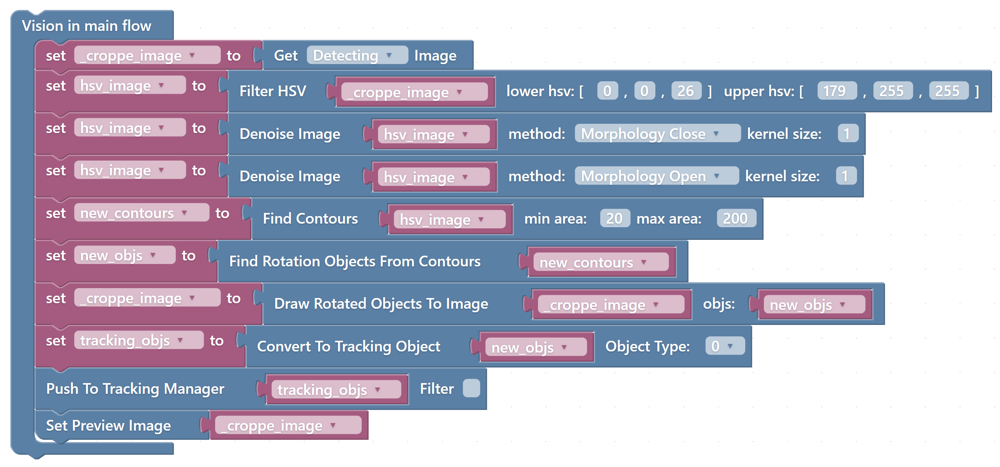

# Blockly example — Color filtering

Vision-only example · HSV

[Color detection setup](../vision/color.md)

This vision-only program detects objects from an HSV mask and sends them to the tracking manager as object type 0. It also draws the detected objects in the camera preview. It contains no robot movement blocks.

Complete [Calibration](../calibration.md) and prepare [Color filtering](../vision/color.md#prepare-the-color-detection-task) before running. Keep robot movement stopped while adjusting detection.

## Prepare the vision task

1. Open Settings → System → Vision AI Settings. Set the main Vision AI switch to Disabled and also disable the System Template Matching switch. Click Save System and wait for confirmation. To locate the switches, open [Find the Vision AI and Template Matching switches](../blockly.md#enable-vision-ai-for-movement-examples) and expand the screenshot.
2. Open Programs. Load Docs_ColorFiltering_Draft if it is already in Saved Tasks, or click New and build the sequence shown below. Add Vision → Image Proc → Vision in main flow and connect the image-processing blocks inside it.
3. Use Variables → Create variable to add the names listed in the table below. Use a set block to store each result and the corresponding small variable block as the input to the following step.
4. Keep the robot movement program stopped until you have tested this vision-only task and its preview.

## Block program

<figure class="studio-figure" markdown="1">

<figcaption>Docs_ColorFiltering_Draft: color filtering inside Vision in main flow. Click the image to inspect the blocks.</figcaption>
</figure>

Place the image-processing sequence inside Vision in main flow. Use variables to pass each result to the next block:

| Variable in the image | What it contains | Used by |
| --- | --- | --- |
| `_croppe_image` | The calibrated detection image, later replaced by the annotated preview. | Filter HSV, Draw Rotated Objects To Image, Set Preview Image. |
| `hsv_image` | The binary mask produced by Filter HSV and updated by the two Denoise Image blocks. | Find Contours. |
| `new_contours` | Contours that pass the size limits. | Find Rotation Objects From Contours. |
| `new_objs` | Candidate objects with centers, sizes, and angles. | Drawing and Convert To Tracking Object. |
| `tracking_objs` | Objects converted for the tracking manager. | Push To Tracking Manager. |

The drawing block uses the original detection image and `new_objs`. Send `tracking_objs` to tracking, then use the annotated `_croppe_image` as the preview. Variable names can differ, but the connections must preserve this flow.

## Values shown in the image

| Block setting | Screenshot value | How to use it |
| --- | --- | --- |
| Lower HSV / upper HSV | `[0,0,26]` / `[179,255,255]` | Accepts the full hue and saturation ranges while rejecting very dark pixels. Narrow the bounds for the actual object color and background. |
| Morphology Close / Open | Kernel size `1` for both | A 1 × 1 kernel does not meaningfully clean the mask. Increase only as needed while inspecting the mask; excessive filtering can merge or distort objects. |
| Find Contours | Min area `20`, max area `200` | Despite the field names, the current implementation checks both dimensions of each contour's rotated bounding rectangle, in pixels. Both dimensions must be between 20 and 200 for this example. |
| Convert To Tracking Object | Object Type `0` | All accepted objects from this pipeline use type 0. Use this same index in pick selection and placement logic. |
| Push To Tracking Manager | Filter unchecked | The supplied example leaves this option off. |

These are the values in this screenshot, not universal detection settings. The white-object HSV example in the [Vision guide](../vision/color.md#build-the-vision-pipeline) uses different bounds for a different detection target.

## Check the result

Click Check program and correct any missing connections. Enter your own task name, such as `My_ColorFiltering`, click Save, and wait for confirmation. In Saved Tasks, click the green triangular play button beside your saved task, select the intended robot, and click Run Task. The [run controls](../blockly.md#run-and-stop-a-task) show these buttons. This task processes images and contains no movement actions.

Open the camera preview on Dashboard by clicking the camera in the scene. Temporarily connect `hsv_image` to Set Preview Image so you can see which pixels pass the filter. Stop the task before editing; Check program, Update, and restart it after changing the preview connection. Objects should form separate filled regions against the background.

Restore `_croppe_image` as the preview after tuning. Check for one stable outline per object and no false objects on an empty background. If an object disappears, inspect the mask and size limits; if one object becomes several, inspect gaps and noise in the mask.

Once detection works, follow [Color filtering + pick & place](color-pick-and-place.md) to combine this pipeline and a picking loop in one task. Keep Vision AI disabled. If you prefer built-in picking, use the [vision-only task with Main Task](../pick_and_place.md#choose-how-to-run-the-system) instead.

<figure class="studio-figure compact" markdown="1">

<figcaption>Choose the robot for this saved task before clicking Run Task. The robot name shown is an example.</figcaption>
</figure>
