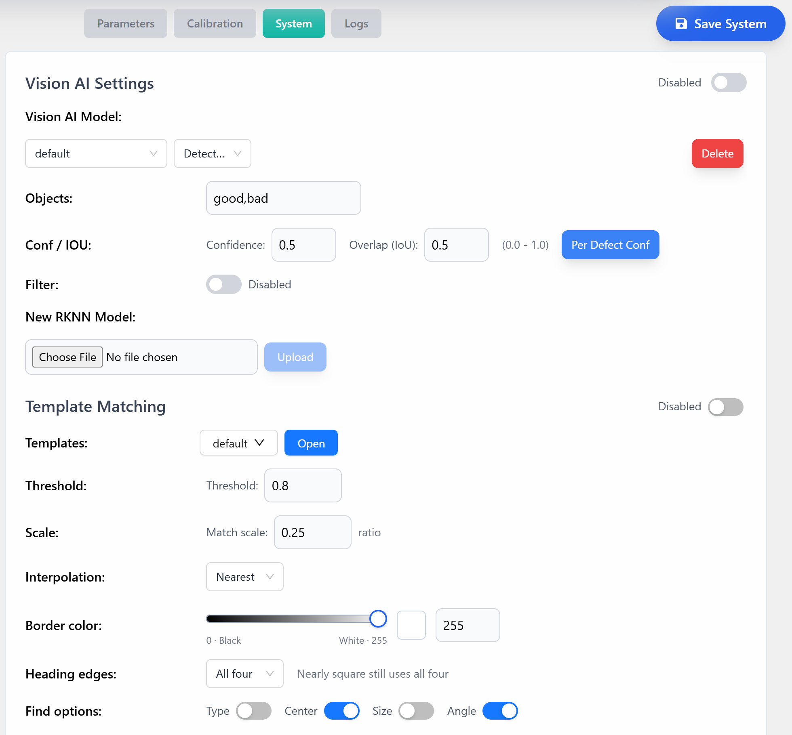
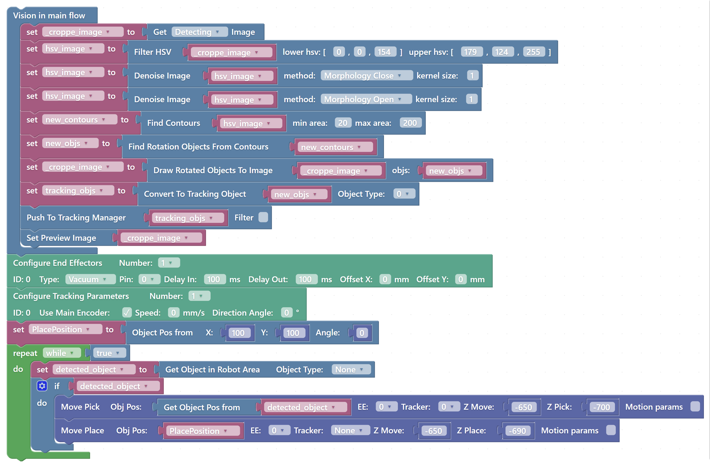
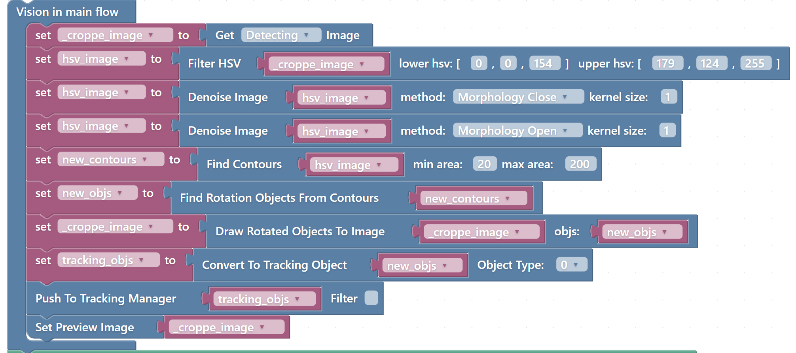
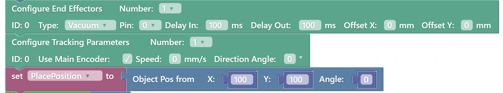
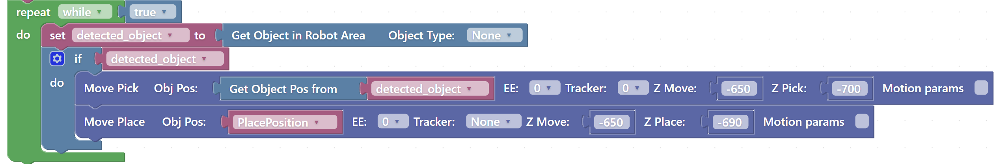

# Blockly example — Color filtering + pick & place

Movement example · HSV + encoder

[Color detection setup](../vision/color.md)

Detect objects by color, pick them from a moving conveyor, and place them at a fixed destination. This example combines the image-processing pipeline and the picking loop in one saved task. Keep Vision AI disabled; no trained AI model is needed.

Complete [System Setup](../../deltaxstudio.md) and the appropriate conveyor [Calibration](../calibration.md), including encoder tracking. First test the [vision-only Color filtering example](color-filtering.md) until each object has one stable detection and an empty belt produces none. Stop that test task before using the combined program.

## Prepare color detection

Open Settings → System → Vision AI Settings. Set both the main Vision AI switch and the System Template Matching switch to Disabled, then click Save System and wait for confirmation.

<figure class="studio-figure" markdown="1">

<figcaption>Keep both switches Disabled for this color-only detection pipeline. The selected AI model is not used.</figcaption>
</figure>

Use the HSV bounds, contour limits, and camera setup that worked in your vision-only test. The combined program must use that same detection pipeline so it supplies the same objects to tracking.

## Block program

<figure class="studio-figure" markdown="1">

<figcaption>Docs_ColorPickPlace_Draft, saved in DeltaXStudio with a fixed destination, working heights, EE 0, and pickup tracker 0. Click to enlarge.</figcaption>
</figure>

Open Programs. If Docs_ColorPickPlace_Draft is in Saved Tasks, click its name to edit it. Otherwise start from your tested color-filtering program and add the configuration blocks and picking loop shown above. Save your completed version under your own name.

The program has two parts. Put the image-processing blocks inside Vision in main flow. Connect the tool configuration, tracking configuration, PlacePosition assignment, and movement loop after that wrapper, outside its image-processing body.

## Image processing

<figure class="studio-figure block-detail" markdown="1">

<figcaption>The vision section detects objects and supplies them to tracking.</figcaption>
</figure>

The camera pipeline reads Get Detecting Image, applies Filter HSV and the two Denoise Image blocks, finds contours, and converts them to rotated objects. Use Draw Rotated Objects To Image and Set Preview Image to display the result. The [color-filtering example](color-filtering.md#block-program) explains each variable and connection.

Pass `new_objs` through Convert To Tracking Object with Object Type `0`. Store the result in `tracking_objs` and connect that variable to Push To Tracking Manager. These two blocks make detections available to the picking loop; drawing outlines alone does not supply objects for pickup.

The captured draft uses lower HSV `[0,0,154]` and upper HSV `[179,124,255]`, selecting bright pixels with low saturation. Its contour size limits are `20`–`200` pixels on both rotated bounding-box dimensions, and both morphology kernels are `1`. Use your tested settings rather than copying these values for a different object or background. See [Verify color detection](../vision/color.md#verify-detection-before-picking) for detection adjustments.

## Tool, tracking, and initialization

<figure class="studio-figure block-detail" markdown="1">

<figcaption>The movement setup follows the vision wrapper, outside its image-processing body.</figcaption>
</figure>

Configure End Effectors defines tool `0`: a vacuum tool on pin `0`, with `100 ms` grip/release delays and zero X/Y offsets in the screenshot. Set the pin, delays, and offsets for your installed tool. Select that tool ID as EE on both Move Pick and Move Place.

Configure Tracking Parameters defines tracker `0` with Use Main Encoder selected and direction angle `0°`. Match the direction to your calibrated conveyor. With Use Main Encoder selected, the encoder supplies the conveyor movement; the displayed Speed value is not a command to run the conveyor.

The next block assigns PlacePosition = [100, 100, 0] using Object Pos from. This defines the fixed placement X, Y, and Angle.

Home the robot and set motion parameters before the first test. To include this preparation in the program, add Go Home and Set Motion Params from Robot Control → Movement before the repeat loop. Enter F, A, J, S, and E once; they continue to apply to later movements until changed.

## Picking loop

<figure class="studio-figure block-detail" markdown="1">

<figcaption>Read objects supplied by the color pipeline, then pick and place when one is available.</figcaption>
</figure>

Inside repeat while true, set `detected_object` to Get Object in Robot Area. Select Object Type `0` to retrieve the objects produced by this pipeline. The screenshot shows `None`, which accepts any available type.

The condition if detected_object means “an object was found.” Keep the pick and place actions inside this condition so an empty lookup skips movement.

| Input | Value shown |
| --- | --- |
| Move Pick → Obj Pos | Get Object Pos from `detected_object`, as shown. |
| Move Pick → EE / Tracker | EE `0`, Tracker `0` for encoder-tracked pickup. |
| Move Pick → Z Move / Z Pick | `-650` / `-700`: transfer and pickup heights. |
| Move Place → Obj Pos | PlacePosition, assigned `[100, 100, 0]` before the loop. |
| Move Place → EE / Tracker | EE `0` to release the same tool; Tracker `None` for the fixed destination. |
| Move Place → Z Move / Z Place | `-650` / `-690`: transfer and release heights. |

Measure the heights and destination for your installation before replacing these values. Use number blocks from Math for height inputs. To define PlacePosition, create the variable under Variables, connect Vision → Objects → Object Pos from to its set block, and fill X, Y, and Angle. Connect a PlacePosition variable block to Move Place → Obj Pos. This position block does not enable or require AI. See [Fill an empty input](../blockly.md#fill-an-empty-input) and [Pick & Place parameters](../pick_and_place.md#configure-the-pick-and-place-parameters) for the inputs and height meanings.

After placement, the loop requests another object. If no object is available, it skips the movement branch and tries again.

## Save and test the combined task

1. With the tested color settings copied and the movement values adapted to your installation, click Check program and resolve the reported issues. Save under your own name, such as `My_ColorPickPlace`, and wait for confirmation. Use Update when editing an existing task.
2. Stop the vision-only color task and any other movement task for this robot. The combined task supplies its own detections and movement; run this task alone for the test. Keep Vision AI disabled and Auto Start off while developing it.
3. Home the robot and confirm the motion settings first. In Saved Tasks, click the green triangular play button beside your combined task. Select the intended robot in Select Target Robots, then click Run Task when ready. The task can begin picking as soon as an object becomes available.
4. Open the camera preview from Dashboard. At a low conveyor test speed, introduce one object and observe its detection, pickup, transfer, and release. Then test an empty belt: the loop should skip movement when no object is returned.

The [illustrated run controls](../blockly.md#run-and-stop-a-task) show the task play button, robot selection, and stop behavior. Stop the task before editing detection or movement settings, then Check program, Update, and repeat the test.

If outlines appear but the robot never picks, check Push To Tracking Manager, Object Type, the Robot Pick Area, and the selected tracker. If the pickup error changes with conveyor speed, recheck encoder tracking and calibration. Correct unstable or false detections in the vision-only test before resuming the combined movement task.

<figure class="studio-figure compact" markdown="1">

<figcaption>Choose the robot for this saved task before clicking Run Task. The robot name shown is an example.</figcaption>
</figure>
