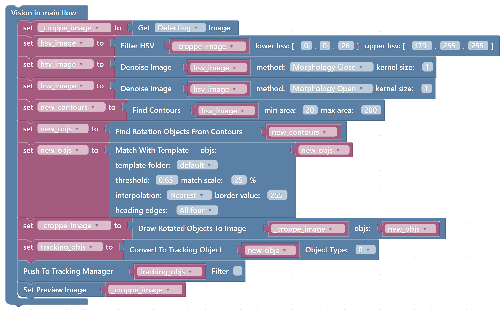

# Blockly example — Color + Template Matching

Vision-only example · HSV + templates

[Color + template setup](../vision/color-template.md)

Start with the [color-filtering example](color-filtering.md), then check its candidate objects against cropped reference images. This is useful when color alone also detects unwanted shapes.

Prepare the template folder using [Color + Template Matching](../vision/color-template.md#prepare-the-reference-templates). Leave Vision AI and the System Template Matching switch off for this Blockly workflow; the Match With Template block performs the matching.

## Prepare the example

1. Complete and test the [color-filtering program](color-filtering.md) first so you can see the candidate objects before adding matching.
2. Open Settings → System → Vision AI Settings. Set the main Vision AI switch and the separate Template Matching switch to Disabled, then click Save System. To locate the switches, open [Find the Vision AI and Template Matching switches](../blockly.md#enable-vision-ai-for-movement-examples) and expand the screenshot.
3. Prepare a template folder containing cropped reference images for your objects. In Programs, build the color pipeline shown below and insert Match With Template between object extraction and drawing. Select your prepared folder on that block.

If no reference folder is ready, follow [Prepare the reference templates](../vision/color-template.md#prepare-the-reference-templates) before testing matching. The screenshot selects `default`; choose a folder containing the reference images prepared for your objects.

## Block program

<figure class="studio-figure" markdown="1">

<figcaption>Docs_ColorTemplateMatching_Draft captured in DeltaXStudio. Select your prepared template folder and tune the filter values for your objects.</figcaption>
</figure>

Keep the image read, HSV filter, denoising, contour extraction, and Find Rotation Objects From Contours blocks from the color example. Insert Match With Template after candidate-object extraction. In this program, its output is assigned back to `new_objs`, replacing the candidate list with the matched list.

| Connection | Value to use |
| --- | --- |
| Match With Template objects input | `new_objs`, the candidate objects from contours. |
| Draw Rotated Objects To Image objects input | `new_objs`, after the matching assignment. |
| Convert To Tracking Object objects input | `new_objs`, after the matching assignment. |
| Push To Tracking Manager | The converted matched objects. |
| Set Preview Image | The image annotated with matched objects. |

Both preview and tracking must use the matched list. Keep the matching assignment before drawing and conversion so candidates cannot bypass the template check.

## Configure the match

Select the actual template folder in Match With Template, then set its threshold and scale. A higher threshold is stricter and may reject valid objects as well as unwanted ones. The block's scale is a percentage: `25%` corresponds to `0.25` in System settings.

The screenshot selects folder `default`, threshold `0.65`, and scale `25%`. Choose your own prepared template folder and tune these values against representative images. The HSV, contour, and denoising settings are inherited from the [color-filtering example](color-filtering.md#values-shown-in-the-image).

The current block also shows interpolation `Nearest`, border value `255`, and heading edges `All four`. These are the defaults retained in this draft; check the matching preview and reported angle against your prepared templates.

The templates should use the same camera, crop, lighting, and object height as the test images. Check the final center, size, and angle. This example sets Object Type to `0` in Convert To Tracking Object, so all objects sent to tracking use type `0`; it demonstrates shape filtering, not sorting by template type. See [Configure Match With Template](../vision/color-template.md#configure-match-with-template) for the settings.

## Compare candidates and matches

Click Check program and correct missing connections, then save under a name such as `My_ColorTemplateMatching`. Click the saved task's green triangular play button, select the intended robot, and click Run Task. Keep movement tasks stopped for this vision test. Use the [illustrated run controls](../blockly.md#run-and-stop-a-task) if needed.

First confirm that the color mask and contour settings produce useful candidates. Then inspect the preview drawn from the updated `new_objs`. Test valid objects and similarly colored objects that should be rejected.

Stop before changing a block or its values. After editing, Check program and Update the task, then run it again and compare the preview.

If all candidates disappear after matching, check the folder contents, template crop, object scale, and threshold. Once the final detections are stable, use the task layout in [Color filtering + pick & place](color-pick-and-place.md), retaining Match With Template before Convert To Tracking Object. Test one object with the completed movement inputs.

<figure class="studio-figure compact" markdown="1">

<figcaption>Choose the robot for this saved task before clicking Run Task. The robot name shown is an example.</figcaption>
</figure>
