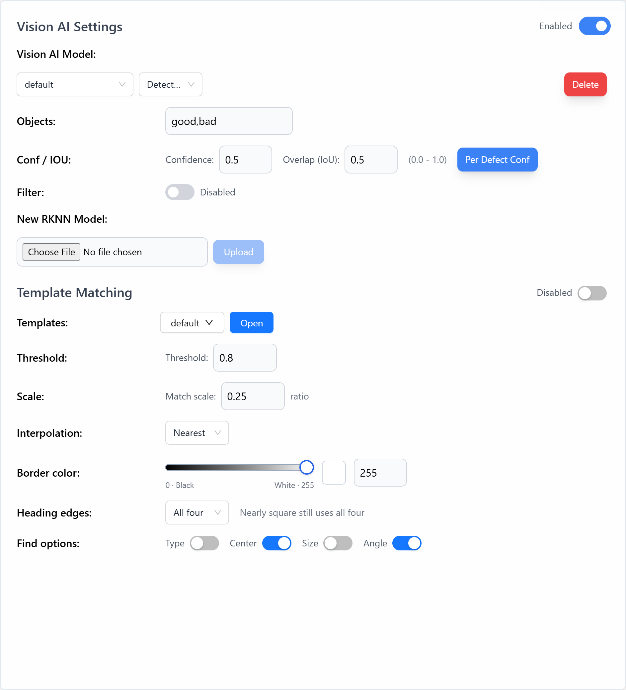
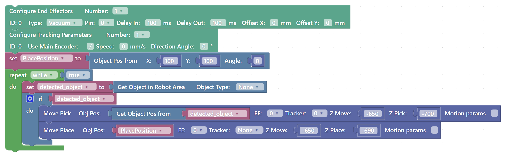
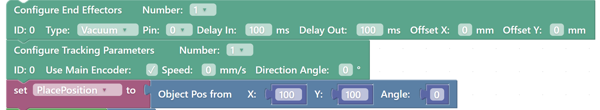
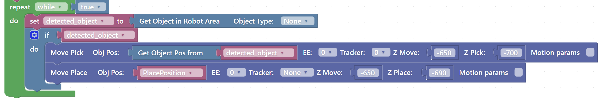

# Blockly example — Conveyor pick & place

Movement example · AI + encoder

[Choose a movement task](../pick_and_place.md#choose-how-to-run-the-system)

Use Vision AI detections and encoder feedback to pick objects from a moving conveyor and place them at a fixed destination. The program shown is saved as Docs_ConveyorPickPlace_Draft in Programs.

Complete the conveyor [Calibration](../calibration.md), configure [AI detection](../vision/ai.md), and start Vision AI before running this movement task. Vision AI supplies the tracked objects; the Blockly program handles pickup and placement.

For HSV color detection and the picking loop in one task, use [Color filtering + pick & place](color-pick-and-place.md), which keeps Vision AI disabled.

## Start Vision AI first

1. Keep the movement task stopped. Open Settings → System → Vision AI Settings.
2. In Vision AI Model, select the model trained for your objects and its matching type: DET, ORI, or SEG. If you have no uploaded model, follow [Upload and enable the model](../vision/ai.md#upload-and-enable-the-model-in-deltaxstudio) first.
3. Enter the trained class names in Objects, separated by commas and in the model's class order. Click the switch beside the Vision AI Settings heading until it reads Enabled. Leave Template Matching disabled for this example.
4. Click Save System at the top right and wait for confirmation. Return to Dashboard and click the camera in the scene to open its preview. Place one test object under the camera and check that it has one stable detection with the correct class.
5. Confirm that the detected object reaches the configured Robot Pick Area. Then complete and run the movement program as described below. Vision AI continues supplying detections while this task picks them.

<figure class="studio-figure" markdown="1">

<figcaption>Set Vision AI to Enabled and leave Template Matching Disabled, as shown. Use the model and classes for your application, then click Save System.</figcaption>
</figure>

The Filter switch below Conf / IOU does not enable AI. If the camera image appears but no object is detected, check the main switch, model/type, class names, and Confidence value using [Verify detection before picking](../vision/ai.md#verify-detection-before-picking).

This example uses the results from Vision AI and does not contain color-filtering or Vision in main flow blocks. See [Choose how to run the system](../pick_and_place.md#choose-how-to-run-the-system) for starting detection and a custom movement task together.

## Block program

<figure class="studio-figure" markdown="1">

<figcaption>Docs_ConveyorPickPlace_Draft as saved in DeltaXStudio. Coordinates and heights illustrate this installation; click to enlarge.</figcaption>
</figure>

## Setup before the loop

<figure class="studio-figure block-detail" markdown="1">

<figcaption>Prepare tool 0, tracker 0, and the fixed destination before entering the loop.</figcaption>
</figure>

Configure End Effectors defines vacuum tool `0` on pin `0`, with `100 ms` grip and release delays and zero X/Y offsets. Configure these values for the installed tool.

Configure Tracking Parameters defines tracker `0` with Use Main Encoder enabled and direction angle `0°`. Verify the selected encoder and tracking direction during conveyor calibration.

Before the loop, Object Pos from assigns the fixed destination to PlacePosition. The working heights are entered directly on Move Pick and Move Place.

| Value shown | Purpose |
| --- | --- |
| `PlacePosition = [100, 100, 0]` | Fixed destination X, Y, and Angle. |
| `Z Move = -650` | Transfer height on both moves. |
| `Z Pick = -700` | Height at which the tool picks an object. |
| `Z Place = -690` | Height at which the tool releases the object. |

Measure the working heights for your robot, tool, belt, and destination. See [Pick & Place parameters](../pick_and_place.md#configure-the-pick-and-place-parameters) for the role of each height.

Home the robot and set motion parameters before the first test. To include this preparation in the program, add Go Home and Set Motion Params before the repeat loop. Set F, A, J, S, and E once; they continue to apply to later movements until changed.

## Retrieve, pick, and place

<figure class="studio-figure block-detail" markdown="1">

<figcaption>The loop uses a tracked pickup and a fixed placement. Click to inspect its inputs.</figcaption>
</figure>

The repeat-while-true loop assigns the result of Get Object in Robot Area to `detected_object`. Object Type is `None`, so the lookup is not restricted to one class.

The `if detected_object` condition runs the movement sequence only when an object is available. Get Object Pos from detected_object supplies its pose directly to Move Pick. The pick selects end effector `0`, tracker `0`, Z Move `-650`, and Z Pick `-700`.

Move Place reads PlacePosition and places at `X100 Y100`, angle `0°`, using Z Move `-650` and Z Place `-690`. It selects EE `0` to release the same vacuum tool, and Tracker `None` for the fixed destination. The loop then requests another object; a no-object result skips the movement branch.

## Adapt the program

To build your own version, start from Programs → Templates → Conveyor pick & place and complete its inputs using the structure above. Match the program to the installation:

Drag number blocks from Math into empty height inputs. For a fixed destination using a Move Place block with Obj Pos, use Vision → Objects → Object Pos from and fill its X, Y, and Angle inputs with number blocks. Select the configured EE on both pick and place. See [Fill an empty input](../blockly.md#fill-an-empty-input) for these basic editor actions.

| Setting | Check before running |
| --- | --- |
| Tracker | The tracker selected for the pick corresponds to the configured conveyor and encoder. |
| Encoder | Counts respond in the expected direction when the conveyor moves. |
| Detected object | The camera recognizes the intended type and objects enter the robot's configured pick area. |
| Pick and transfer heights | The installed tool reaches the object and clears the belt and fixtures during transfer. |
| Place action | The destination and its tracking selection match the actual placement setup. |

Check and save the adapted task. Add [type-based branches](sort-two-types.md) when different AI classes need different destinations.

## Test tracking

1. Click Check program and resolve any missing inputs. Enter your own task name, such as `My_ConveyorPickPlace`, and click Save. Use Update when editing an existing task, and wait for the saved confirmation.
2. In Saved Tasks, click the green triangular play button beside that task. In Select Target Robots, select the intended robot only.
3. With Vision AI already detecting correctly, click Run Task for the first movement test. Start the conveyor at a low test speed and introduce one object. Confirm pickup, transfer clearance, and release.

<figure class="studio-figure compact" markdown="1">

<figcaption>The green play button opens this dialog. Select your robot, then click Run Task to start the movement program.</figcaption>
</figure>

While the task runs, its play button becomes a square Stop task button. Stop the task before correcting heights, positions, or tool settings, then Check program and Update again. The header Run button starts the task selected in Run Button Task; use the button beside your saved program for this test.

Test an empty belt as well: no-object results must not cause movement or pose-reading errors. Repeat at different object positions before increasing supply. If the miss changes with conveyor speed, check tracking and encoder direction rather than compensating only with a fixed position offset.
