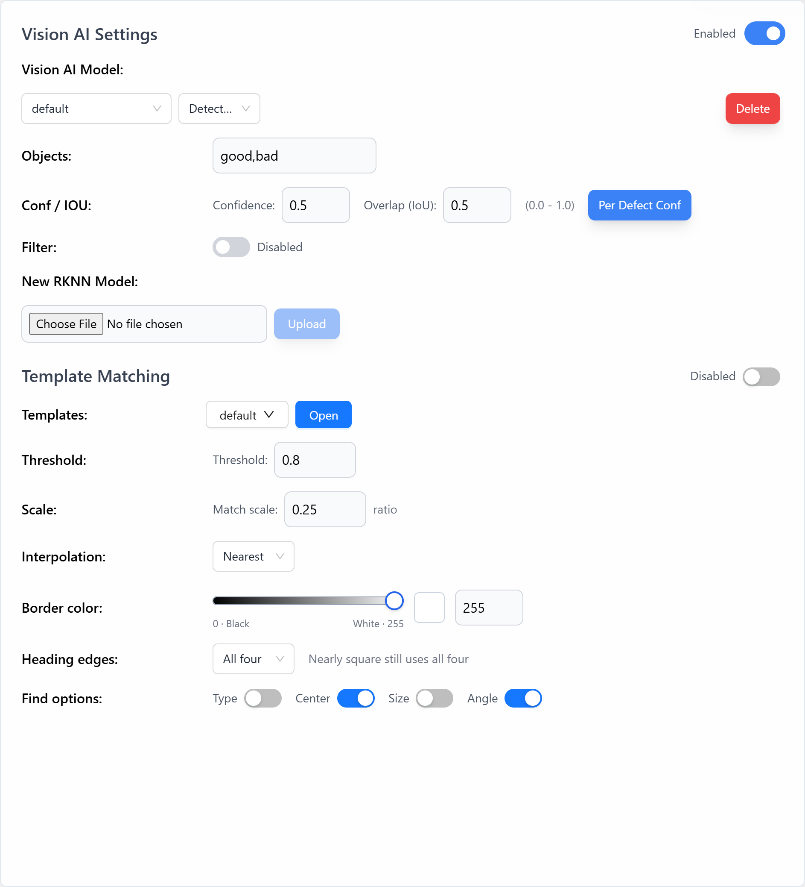
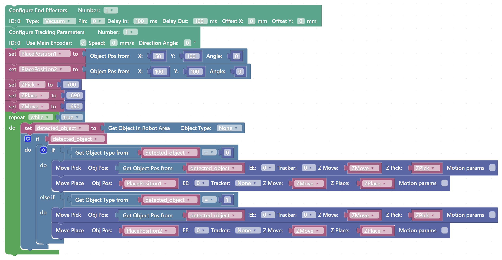
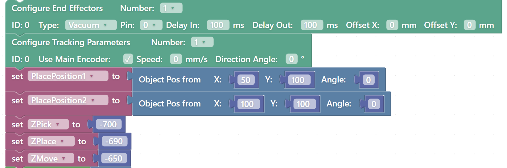
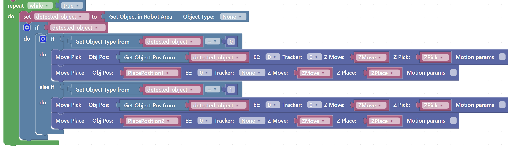
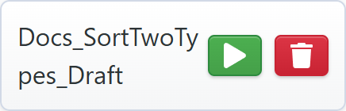

# Blockly example — Sort two object types

Movement example · AI sorting

[Choose a movement task](../pick_and_place.md#choose-how-to-run-the-system)

Send detected type `0` to one destination and type `1` to another. The program shown is saved as Docs_SortTwoTypes_Draft and uses encoder tracking for pickup. To build your own version, start from Programs → Templates → Sort two object types and adapt the two movement branches to your application.

This guide uses Vision AI to distinguish the objects. Complete [Calibration](../calibration.md) and use an AI model trained for at least two classes before starting the movement program.

## Set up Vision AI

1. Keep movement tasks stopped. Open Settings → System → Vision AI Settings.
2. Select your trained model and its matching model type, DET, ORI, or SEG. If it is not uploaded yet, follow [Upload and enable the model](../vision/ai.md#upload-and-enable-the-model-in-deltaxstudio).
3. Enter the model's full class list in Objects, in its original order. For a model trained with `part_A` first and `part_B` second, enter `part_A,part_B`. These become types `0` and `1` in the program.
4. Set the switch beside the Vision AI Settings heading to Enabled. Leave Template Matching disabled for this example, then click Save System at the top right and wait for confirmation.
5. Return to Dashboard and click the camera in the scene to open the preview. Test one object of each class. Continue only when both have stable detections with the expected classes.

<figure class="studio-figure" markdown="1">

<figcaption>Enable Vision AI and leave Template Matching Disabled, then click Save System. The pictured good,bad names are examples; use a model trained for your two object types and enter its full class list in model order.</figcaption>
</figure>

Adding another name to Objects does not train a new class. If your model recognizes only one class, complete the [AI training guide](../vision/ai.md) with both object classes first. The separate Filter switch is not the main AI switch.

## Block program

<figure class="studio-figure" markdown="1">

<figcaption>Docs_SortTwoTypes_Draft with two destinations and working heights entered. Adapt these values to your conveyor, tool, and placement locations.</figcaption>
</figure>

## Setup before the loop

<figure class="studio-figure block-detail" markdown="1">

<figcaption>Define the tool, tracker, two destinations, and working heights before sorting.</figcaption>
</figure>

Before the loop, Configure End Effectors defines vacuum tool `0` on pin `0`, with `100 ms` grip/release delays and zero X/Y offsets. Configure Tracking Parameters defines tracker `0`, using the main encoder and direction angle `0°`.

## Retrieve, pick, and sort

<figure class="studio-figure block-detail" markdown="1">

<figcaption>Each class uses the same pickup logic and its own placement variable.</figcaption>
</figure>

The loop retrieves an object into `detected_object`. The if detected_object condition allows the movement branches to run only when an object is available, before reading its type or pose.

Inside the object-found condition, compare Get Object Type against `0`. In that branch, pick using Get Object Pos and place at destination A. Add an else-if comparison against `1`; that branch picks the detected object and places it at destination B.

After a branch finishes, the loop requests the next object. The example has no pick/place branch for other types.

## Define the destinations

| Detection result | Program action |
| --- | --- |
| No object (`None`) | Skip the movement branches and request an object again. |
| Type `0` | Move Pick at the detected pose, then Move Place using `PlacePosition1 = [50, 100, 0]`. |
| Type `1` | Move Pick at the detected pose, then Move Place using `PlacePosition2 = [100, 100, 0]`. |
| Another type | No pick/place branch in this example; add handling only if the application requires it. |

Check type indices against the final Vision output. For AI they depend on the model's class order; if Template Matching supplies the type, verify its template-index mapping. Do not identify a branch only by the displayed object name.

Both branches use the same height variables:

| Variable | Value shown | Purpose |
| --- | --- | --- |
| `ZPick` | `-700` | Tool height for gripping an object. |
| `ZPlace` | `-690` | Tool height for releasing an object. |
| `ZMove` | `-650` | Transfer height on both pick and place. |

Both Move Pick blocks select EE `0` and Tracker `0`. Both Move Place blocks select EE `0` and Tracker `None` because the destinations are fixed.

## Complete the template

When starting from Programs → Templates → Sort two object types, the branch conditions are already connected. Complete its movement inputs using the saved example above:

| Part of the program | What to do |
| --- | --- |
| Configure End Effectors | Set the actual tool type, output pin, and grip/release delays. Note its ID, such as `0`. |
| Get Object in Robot Area | Keep Object Type at `None` so the lookup can return either class. |
| Position and height variables | Use Variables → Create variable to create PlacePosition1, PlacePosition2, ZPick, ZPlace, and ZMove. Assign the two positions with Vision → Objects → Object Pos from; fill X, Y, Angle, and height values using number blocks from Math. |
| Move Pick in both branches | Keep Get Object Pos connected to Obj Pos. Select the installed EE; connect ZMove to Z Move and ZPick to Z Pick. |
| Move Place for type `0` | Connect PlacePosition1 to Obj Pos, ZMove to Z Move, and ZPlace to Z Place. Select the same EE as pickup. |
| Move Place for type `1` | Repeat with PlacePosition2 as Obj Pos. |
| Motion settings | Set F, A, J, S, and E once before the picking loop using Robot Control → Movement → Set Motion Params. They continue to apply until changed. |

For a moving conveyor, add Configure Tracking Parameters before the loop and select its tracker on both Move Pick blocks, as shown in the saved example. Follow the [conveyor example](conveyor-pick-and-place.md#setup-before-the-loop) for encoder setup. For fixed objects and fixed destinations, use Tracker `None`.

Use [Fill an empty input](../blockly.md#fill-an-empty-input) if you are new to number blocks and Object Pos from. Measure the actual heights and destinations before replacing the values shown in the screenshot.

Home the robot before the first position-based test. To include homing in this program, connect Robot Control → Movement → Go Home before the picking loop.

The [color-filtering example](color-filtering.md) sends every object as type `0`. It cannot supply both branches of this AI sorting example.

## Test each branch

1. Click Check program and correct the reported missing inputs or errors. Save under your own task name, such as `My_TwoTypeSorting`, and wait for confirmation.
2. With Vision AI already detecting both classes, find that task in Saved Tasks and click its green triangular play button.
3. In Select Target Robots, select the intended robot and click Run Task. Present one type-0 object and confirm destination A, then one type-1 object and confirm destination B.

<figure class="studio-figure" style="max-width:280px" markdown="1">

<figcaption>Use the green triangle beside your completed, saved task. Your task name may differ from this draft.</figcaption>
</figure>

Check both grip/release actions and transfer clearances before testing a mixed sequence. While running, the play button changes to a square Stop task button. Stop before editing, then Check program and Update the saved task before the next test.

If destinations are swapped, inspect the detected type and branch comparison first. If an unexpected type is detected, the example should not execute either movement branch.

<figure class="studio-figure compact" markdown="1">

<figcaption>Choose the robot for this saved task before clicking Run Task. The robot name shown is an example.</figcaption>
</figure>
