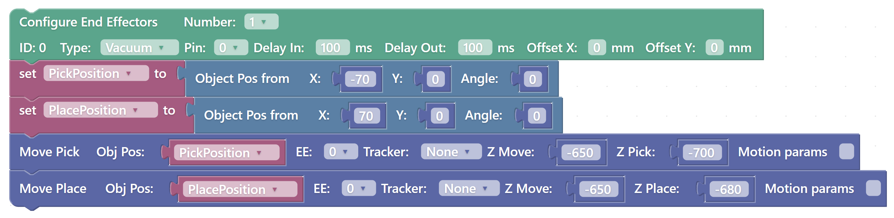
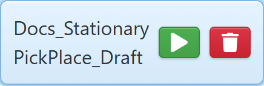
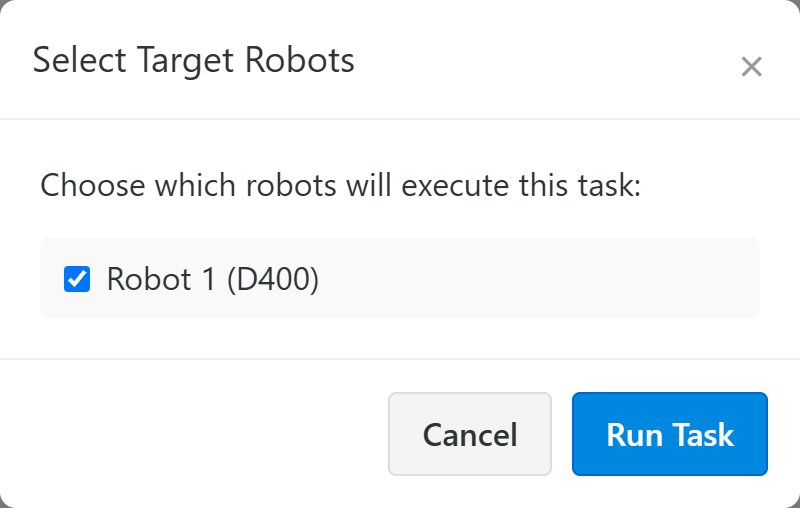

# Blockly example — Stationary pick & place

Movement example · Fixed positions

[Choose a movement task](../pick_and_place.md#choose-how-to-run-the-system)

Pick one object from a known, fixed position and release it at a fixed destination. This example uses entered poses rather than camera detections; it does not need a vision pipeline or conveyor tracking.

Vision AI is not required for this example. The robot uses the positions you enter in the blocks. Complete [System Setup](../../deltaxstudio.md) and check the installed gripping tool before building the program.

The program shown is saved as Docs_StationaryPickPlace_Draft. It defines the pick and place positions in variables, then performs one pick and one place. To build your own version, start from Programs → Templates → Stationary pick & place and enter the values for your installation.

## Block program

<figure class="studio-figure" markdown="1">

<figcaption>Docs_StationaryPickPlace_Draft with the entered poses and heights. These values illustrate one setup; measure them for your installation.</figcaption>
</figure>

Configure End Effectors defines vacuum tool `0` on pin `0`, with `100 ms` grip and release delays and zero X/Y offsets. The next two blocks assign PickPosition and PlacePosition using Object Pos from.

Move Pick reads PickPosition; Move Place reads PlacePosition. Both select EE `0` and Tracker `None` because the object and destination are fixed.

| Value shown | Purpose |
| --- | --- |
| `PickPosition = [-70, 0, 0]` | Pickup X, Y, and Angle. |
| `PlacePosition = [70, 0, 0]` | Destination X, Y, and Angle. |
| `Z Move = -650` | Transfer height on both moves. |
| `Z Pick = -700` | Pickup height. |
| `Z Place = -680` | Release height. |

Keep this first example as a single cycle. Adding a loop would repeat the pick even if no replacement object had been supplied.

## Fill the inputs

Use Dashboard jogging to find the pickup and destination positions with your installed tool, and record the required X, Y, angle, and working heights. Adapt the example, or complete the empty inputs when starting from the template:

1. In Configure End Effectors, choose the actual tool type and output pin. Set the grip/release delays and note the tool ID, such as `0`.
2. Open Variables → Create variable and create PickPosition. Connect Object Pos from, found under Vision → Objects, to a set PickPosition to block. Fill its X, Y, and Angle inputs with number blocks from Math, and connect a PickPosition variable block to Move Pick → Obj Pos. Object Pos from only groups the entered coordinates; it does not turn on AI.
3. Repeat with PlacePosition and connect that variable to Move Place → Obj Pos. Enter the measured destination and fill Z Move and Z Pick/Z Place with number blocks from Math.
4. Select the configured EE on both movement blocks. Set both Tracker dropdowns to `None` because these positions are fixed.
5. Home the robot and set motion parameters before the first test. To include this preparation in the program, connect Robot Control → Movement → Go Home and Set Motion Params before Move Pick. Enter F, A, J, S, and E once; they continue to apply to later movements until changed.

| Input | What to enter |
| --- | --- |
| Pick pose | The known object position and required tool orientation. |
| Place pose | The destination position and release orientation. |
| Pick and place heights | Heights appropriate for the installed tool, object, and destination. |
| Transfer height | A height that clears the carried object and fixtures throughout the move. |
| End effector and delays | The actual tool configuration and enough time to grip/release; check the units shown on the blocks. |
| Motion parameters | Values already checked for this robot and application. |

Determine coordinates using the installed tool. For the meaning of working heights and dwell times, see [Pick & Place parameters](../pick_and_place.md#configure-the-pick-and-place-parameters). Configure the block inputs explicitly rather than assuming that values in a different program have been copied.

## Run one cycle

Click Check program and fill any missing inputs it reports. Enter a new task name, such as `My_StationaryPickPlace`, click Save, and wait for confirmation. Saving the program does not start it.

Place one object at the specified pickup position. In Saved Tasks, click the green triangular play button beside your task, select the intended robot in Select Target Robots, and click Run Task. Observe pickup, clearance during transfer, and release. The sequence should perform one pick/place cycle and finish. See the [illustrated run controls](../blockly.md#run-and-stop-a-task) if this is your first saved task.

Stop before correcting a pose or height. If the tool reaches the object but does not grip or release it, check tool operation and the corresponding delay before changing coordinates.

<figure class="studio-figure" style="max-width:280px" markdown="1">

<figcaption>Click the green triangle beside your saved stationary task to choose the target robot.</figcaption>
</figure>

<figure class="studio-figure compact" markdown="1">

<figcaption>Select the intended robot, then click Run Task when the workspace and first-cycle inputs have been checked.</figcaption>
</figure>
