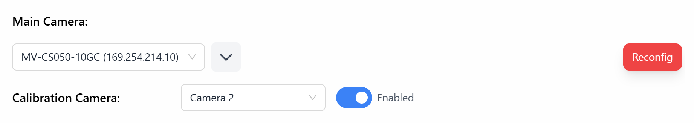
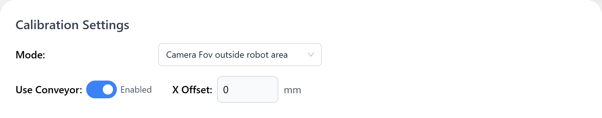
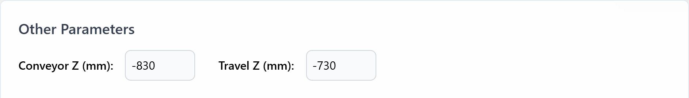
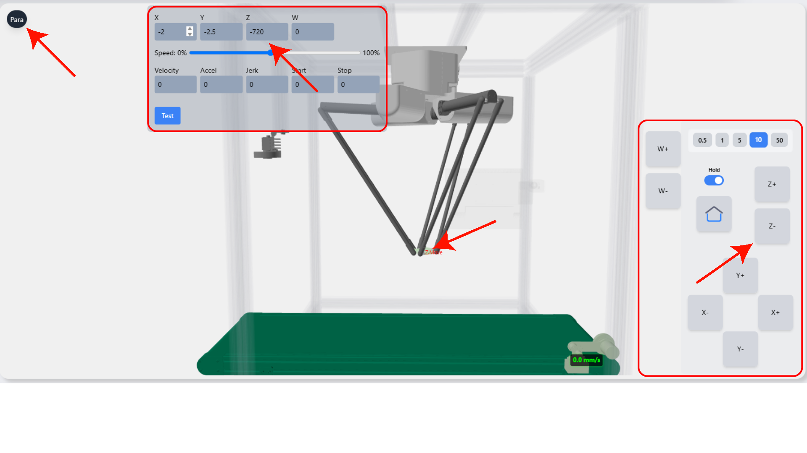
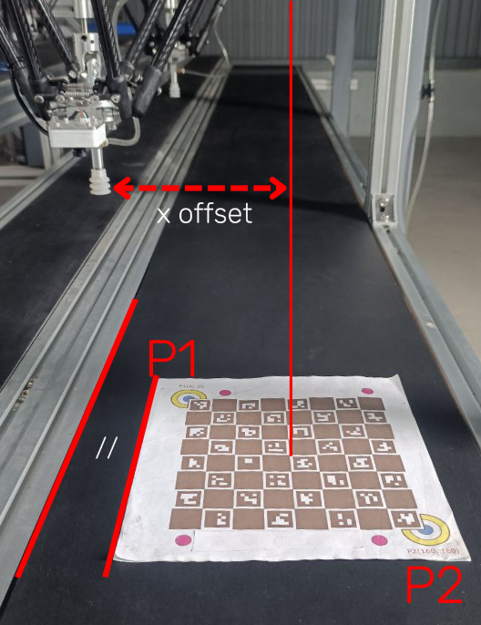
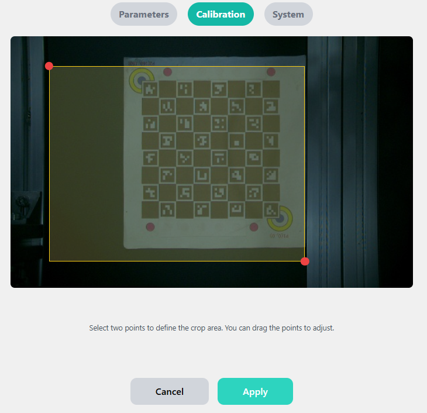
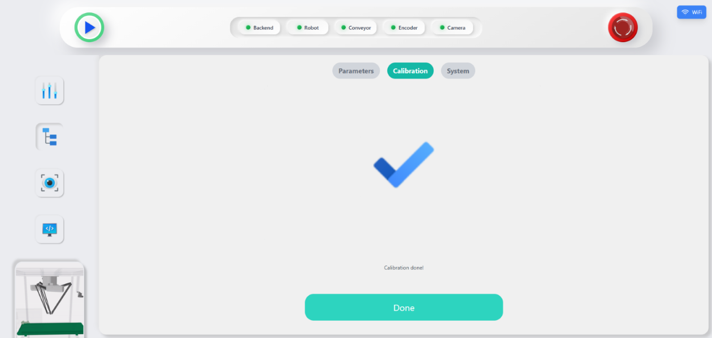

# Calibration — Fully automatic

Calibration · Fully automatic

[Change method](../calibration.md)

Use this method when DeltaXStudio can control the conveyor and a calibration camera is installed.

Required: robot + main camera + encoder + calibration camera. DeltaXStudio controls the belt.

Screenshots may show an earlier interface; use the field names in the instructions.

## Configure this setup

Stop running tasks and keep Auto Start disabled. Check the robot and main camera connections. Confirm the encoder counts increase with forward conveyor travel.

In Hardware Settings, enable and select the calibration camera. Check the main camera, robot, encoder, and conveyor connections. In Calibration Settings, select Camera Fov outside robot area and enable Use Conveyor.

Set X Offset to the conveyor centerline's X offset from the robot origin, in millimeters. Use the sign of the robot's X axis. This positions the automatic approach over the belt; it is separate from Robot Center Offset used to fine-tune picking.

Check Conveyor Z, save, reset the system, and wait for the devices to reconnect.

<figure class="studio-figure" markdown="1">

<figcaption>Select and enable the installed calibration camera.</figcaption>
</figure>

<figure class="studio-figure compact" markdown="1">

<figcaption>DeltaXStudio controls conveyor movement.</figcaption>
</figure>

## Check the working height

Open Settings → Parameters and select the intended robot if more than one is configured.

With the conveyor stopped, use the Dashboard robot controls to approach the belt surface with the installed tool. Reduce the jog increment near the surface and avoid pressing the tool into the belt. Read the robot's Z coordinate at the belt surface and enter it in Other Parameters → Conveyor Z (mm). This is the field called Z Conveyor in the reference manual.

Set Travel Z (mm), called Z Move in the manual, to a height that clears the carried object, belt, fixtures, and destination throughout the transfer.

Save the settings before calibration. Automatic calibration uses Conveyor Z to calculate approach positions, so check this value for each configured robot.

<figure class="studio-figure" markdown="1">

<figcaption>Enter the measured conveyor-surface Z and a transfer Z with adequate clearance. The pictured values illustrate one installation.</figcaption>
</figure>

<figure class="studio-figure" markdown="1">

<figcaption>Read the current Z coordinate while positioning the installed tool.</figcaption>
</figure>

Three object heights above the belt can be used as an initial estimate for Travel Z. For example, a belt at `Z = -740 mm` and a `20 mm` object gives `-740 + 3 x 20 = -680 mm`. Verify the actual clearance and robot reach; this estimate does not account for every tool or fixture.

If a jog command is rejected, check the displayed status, homing state, and configured travel limits before continuing.

## Place the board and select the crop

Stop the conveyor and place the supplied board flat under the main camera. Align it with the belt and leave enough travel for the capture sequence. Check that the whole board is visible, sharp, and well lit.

Open Settings → Calibration and click Start. Follow any board-orientation guidance. Select two opposite corners of the detection area in the corrected image. Cover the useful conveyor area. Exclude blank image padding. Click Apply. The system is now ready to capture the reference points.

<figure class="studio-figure portrait" markdown="1">

<figcaption>Keep the board aligned with the belt. X Offset describes the conveyor centerline relative to the robot.</figcaption>
</figure>

<figure class="studio-figure compact" markdown="1">

<figcaption>Select the useful detection area, then click Apply.</figcaption>
</figure>

Let the conveyor carry the board between points. Do not lift, slide, or rotate it relative to the belt.

## Capture the reference points

The system moves and stops the conveyor to capture the two main-camera reference positions and encoder readings. As the board advances into the calibration camera's view, the system aligns the robot reference points automatically and repeats the sequence for additional configured robots.

Monitor the current step until calibration reports completion, then click Done.

Do not manually jog the robot or reposition the board during automatic alignment. If the sequence fails, use the reported cause to check board visibility, available travel, camera-to-robot spacing, and approach positions before retrying.

## Confirm calibration

Wait for successful completion; the system validates and saves the reference points. Click Done, then check the corrected image and crop.

<figure class="studio-figure" markdown="1">

<figcaption>Wait for successful completion before clicking Done.</figcaption>
</figure>

Continue to [Vision](../vision.md) to verify detection before the first pick. During the first low-speed picking test, check several object positions and conveyor tracking. Repeat calibration after moving the camera, robot, or conveyor relative to one another.

## If this calibration cannot finish

| Symptom | What to check |
| --- | --- |
| Board not detected | Focus, lighting, board orientation, and complete board visibility. |
| Crop rejected | Select a non-empty area inside the valid corrected image. |
| Missing or reversed encoder feedback | Check the connection and counting direction. Encoder feedback is required for this method. |
| Board passes the capture area | Check available travel and camera-to-robot spacing. |
| Incorrect automatic approach | Check the selected robot, Conveyor Z, and X Offset. |
| Browser reconnects | Wait for the current session state to reload before continuing. |

Use Stop or Cancel to end the workflow and wait for stopping to finish. Calibration Stop waits for robot motion already in progress; use the physical emergency stop if immediate intervention is needed.
