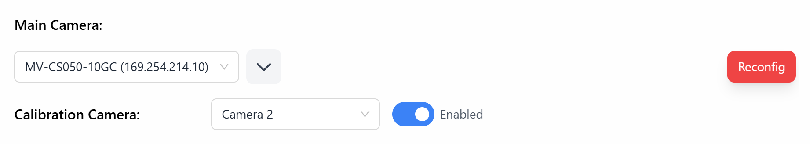
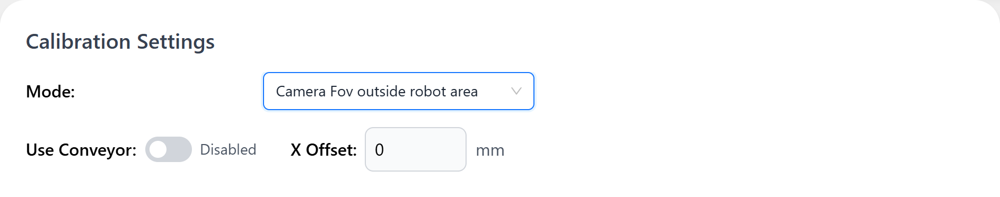
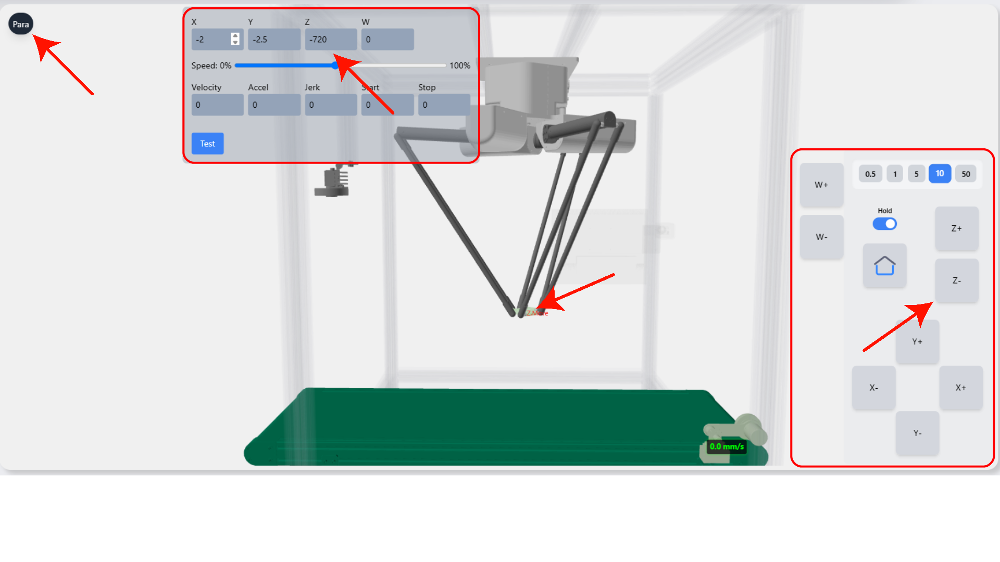
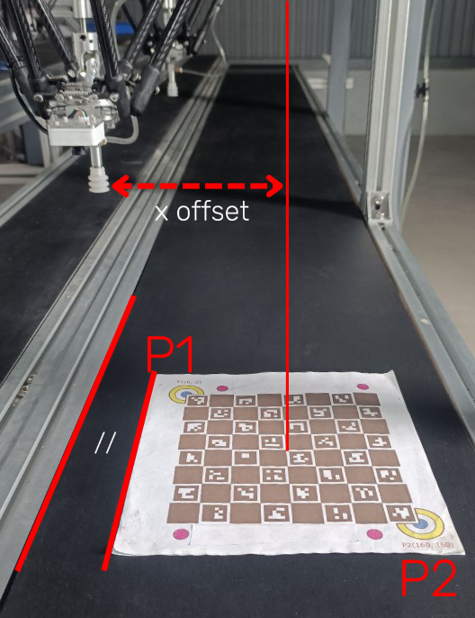
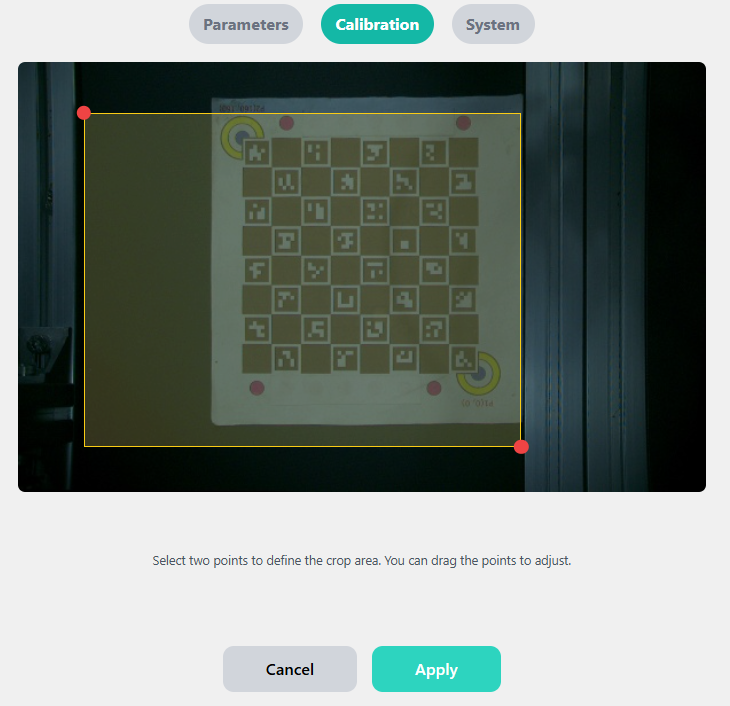
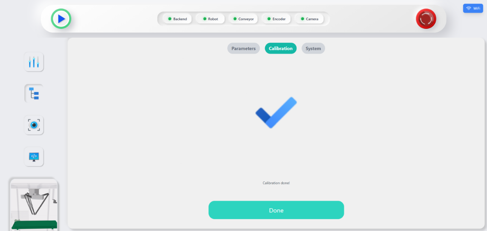

# Calibration — External conveyor · Calibration camera

Calibration · External conveyor · Calibration camera

[Change method](../calibration.md)

Use this method when the operator controls the conveyor externally and a calibration camera is installed.

An encoder connected to DeltaXStudio is required to measure conveyor position. External conveyor control replaces only the software's motor commands; the calibration still uses encoder feedback.

Required: robot + main camera + encoder + calibration camera. The operator starts and stops the belt externally; encoder feedback remains required.

Screenshots may show an earlier interface; use the field names in the instructions.

## Configure this setup

Stop running tasks and keep Auto Start disabled. Check the robot and main camera connections. Confirm the encoder counts increase with forward conveyor travel.

Connect, select, and enable Calibration Camera in Hardware Settings. Select Camera Fov outside robot area and disable Use Conveyor in Calibration Settings. Keep the encoder connected.

Set X Offset to the conveyor centerline's signed X offset from the robot origin, in millimeters. Check Conveyor Z for the installed tool. X Offset positions the automatic approach; it is separate from Robot Center Offset used to fine-tune picking.

Save, reset the system, and wait for reconnection.

<figure class="studio-figure" markdown="1">

<figcaption>Select and enable the installed calibration camera for automatic robot-point alignment.</figcaption>
</figure>

<figure class="studio-figure" markdown="1">

<figcaption>Operate the conveyor externally. Encoder feedback is still required.</figcaption>
</figure>

## Check the working height

Open Settings → Parameters and select the intended robot if more than one is configured.

With the conveyor stopped, use the Dashboard robot controls to approach the belt surface with the installed tool. Reduce the jog increment near the surface and avoid pressing the tool into the belt. Read the robot's Z coordinate at the belt surface and enter it in Other Parameters → Conveyor Z (mm). This is the field called Z Conveyor in the reference manual.

Set Travel Z (mm), called Z Move in the manual, to a height that clears the carried object, belt, fixtures, and destination throughout the transfer.

Save the settings before calibration. Automatic calibration uses Conveyor Z to calculate approach positions, so check this value for each configured robot.

<figure class="studio-figure" markdown="1">

<figcaption>Enter the measured conveyor-surface Z and a transfer Z with adequate clearance. The pictured values illustrate one installation.</figcaption>
</figure>

<figure class="studio-figure" markdown="1">

<figcaption>Read the current Z coordinate while positioning the installed tool.</figcaption>
</figure>

Three object heights above the belt can be used as an initial estimate for Travel Z. For example, a belt at `Z = -740 mm` and a `20 mm` object gives `-740 + 3 x 20 = -680 mm`. Verify the actual clearance and robot reach; this estimate does not account for every tool or fixture.

If a jog command is rejected, check the displayed status, homing state, and configured travel limits before continuing.

## Place the board and select the crop

Stop the conveyor and place the supplied board flat under the main camera. Align it with the belt and leave enough travel for the capture sequence. Check that the whole board is visible, sharp, and well lit.

Open Settings → Calibration and click Start. Follow any board-orientation guidance. Select two opposite corners of the detection area in the corrected image. Cover the useful conveyor area. Exclude blank image padding. Click Apply. The system is now ready to capture the reference points.

<figure class="studio-figure portrait" markdown="1">

<figcaption>Keep the board aligned with the belt. X Offset describes the conveyor centerline relative to the robot.</figcaption>
</figure>

<figure class="studio-figure compact" markdown="1">

<figcaption>Select the useful detection area, then click Apply.</figcaption>
</figure>

Let the conveyor carry the board between points. Do not lift, slide, or rotate it relative to the belt.

## Capture the reference points

1. Watch the on-screen conveyor instruction. When it requests movement, run the belt using its external controls. The manual suggests approximately 20-30 mm/s so the operator has time to respond.
2. When the instruction requests a stop, stop the belt promptly and leave it stationary while the reference point is captured.
3. Repeat the requested start/stop actions as the board travels from the main camera to the calibration camera. The software performs the robot alignment automatically while you control belt movement.
4. Continue until the workflow reports completion, then click Done.

If the board overshoots the required capture area, stop the workflow and restart with the board repositioned. Keep watching the prompts throughout the sequence; Use Conveyor is disabled, so the software cannot command the external belt to stop.

## Confirm calibration

Wait for successful completion; the system validates and saves the reference points. Click Done, then check the corrected image and crop.

<figure class="studio-figure" markdown="1">

<figcaption>Wait for successful completion before clicking Done.</figcaption>
</figure>

Continue to [Vision](../vision.md) to verify detection before the first pick. During the first low-speed picking test, check several object positions and conveyor tracking. Repeat calibration after moving the camera, robot, or conveyor relative to one another.

## If this calibration cannot finish

| Symptom | What to check |
| --- | --- |
| Board not detected | Focus, lighting, board orientation, and complete board visibility. |
| Crop rejected | Select a non-empty area inside the valid corrected image. |
| Missing or reversed encoder feedback | Check the connection and counting direction. Encoder feedback is required for this method. |
| Board passes the capture area | Check available travel and camera-to-robot spacing. Reduce belt positioning speed and stop when prompted. |
| Incorrect automatic approach | Check the selected robot, Conveyor Z, and X Offset. |
| Browser reconnects | Wait for the current session state to reload before continuing. |

Use Stop or Cancel to end the workflow and wait for stopping to finish. Stop an external conveyor using its own controls. Calibration Stop waits for robot motion already in progress; use the physical emergency stop if immediate intervention is needed.
