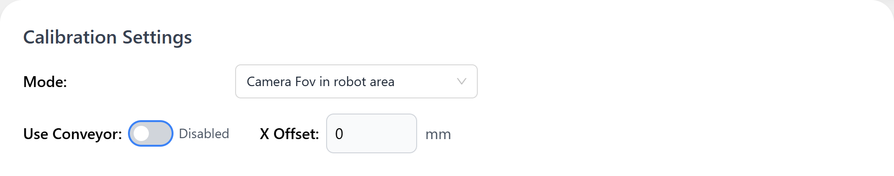
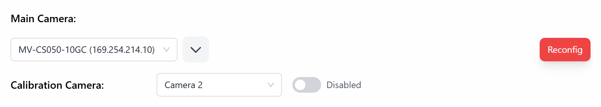
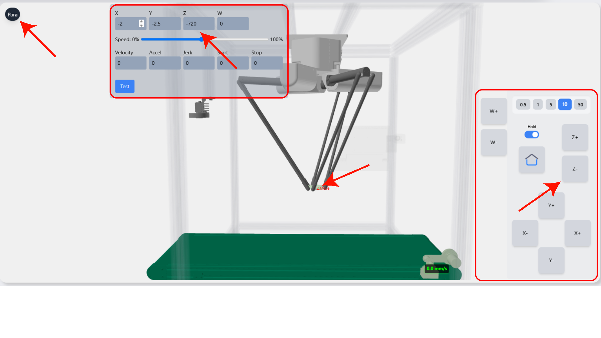
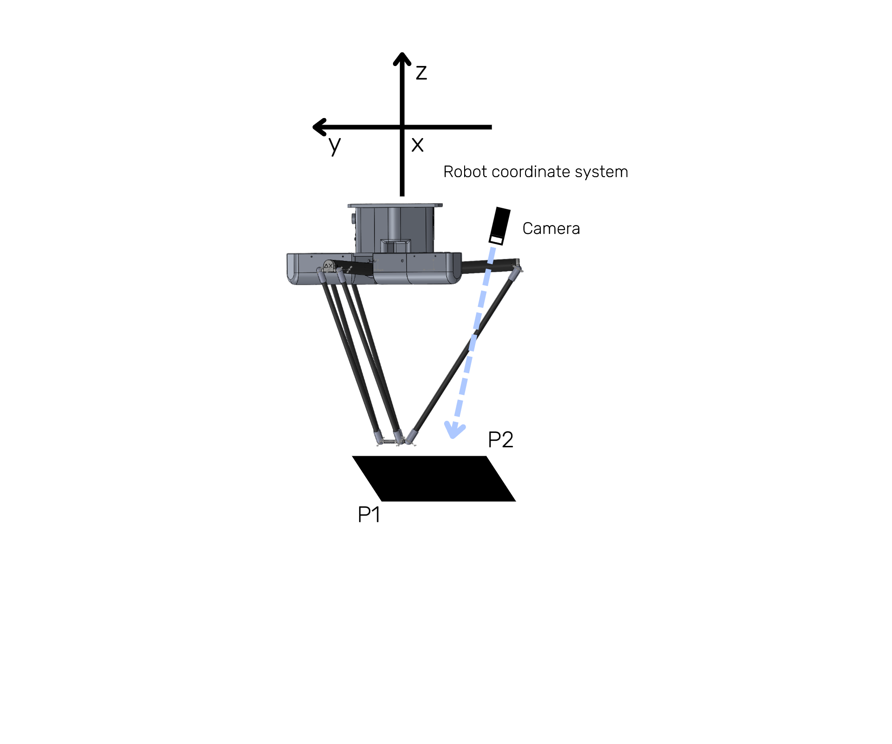
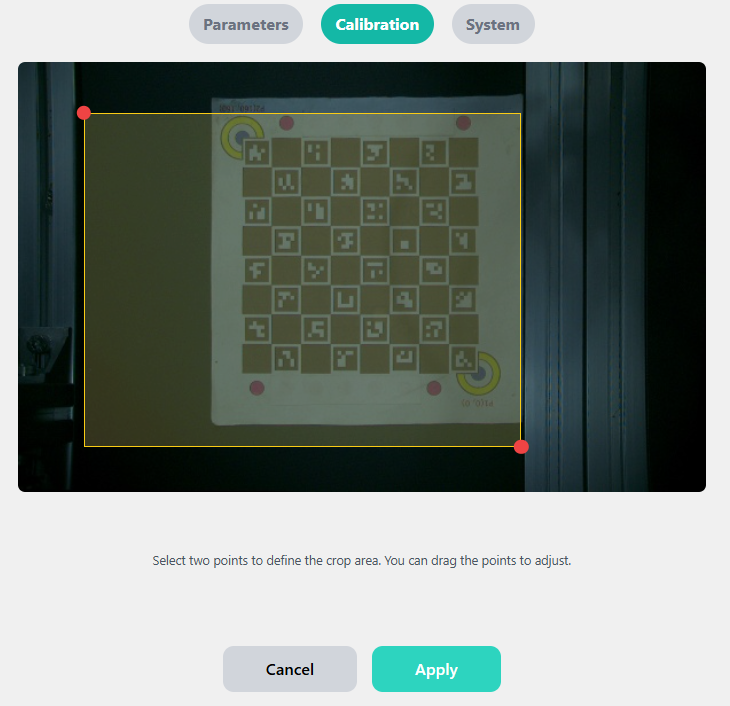
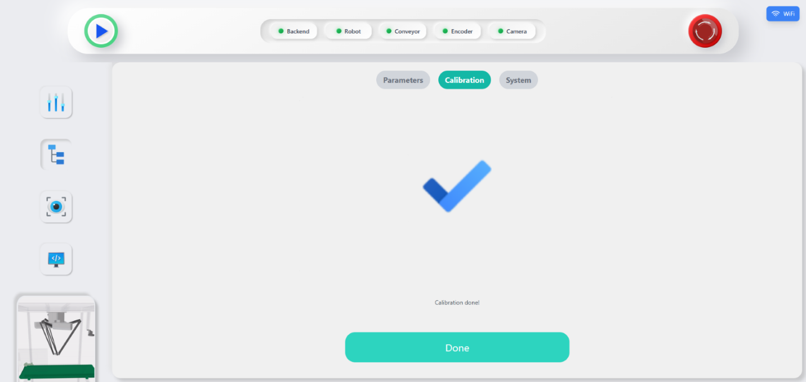

# Calibration — Stationary objects

Calibration · Stationary objects

[Change method](../calibration.md)

Use this method for stationary objects within both the main camera view and the robot workspace. The belt, if present, remains stopped.

Required: robot + main camera. Keep the object and working surface stationary.

Screenshots may show an earlier interface; use the field names in the instructions.

## Configure this setup

Stop running tasks and keep Auto Start disabled. Check the robot and main camera connections.

Select Camera Fov in robot area in Calibration Settings. Disable Use Conveyor and Calibration Camera.

Save, reset the system, and wait for the main camera and robot to reconnect.

<figure class="studio-figure compact" markdown="1">

<figcaption>Static calibration: also disable Calibration Camera.</figcaption>
</figure>

<figure class="studio-figure" markdown="1">

<figcaption>Use the main camera and keep Calibration Camera disabled for the stationary-board workflow.</figcaption>
</figure>

## Check the working height

Fit the intended tool and confirm both reference points are within robot reach. Use small jog increments near the working surface. Keep the tool above the board during point alignment; it does not need to touch it.

<figure class="studio-figure" markdown="1">

<figcaption>Use the coordinate readout while aligning the tool. Keep the board stationary and the tool clear of its surface.</figcaption>
</figure>

The board must stay fixed throughout both point captures. Establish the later Pick Z and Place Z separately when setting up Pick & Place.

## Place the board and select the crop

Place the board flat in the common camera and robot working area. Both reference points must be reachable. Check that the whole board is visible, sharp, and well lit.

Open Settings → Calibration and click Start. Follow any board-orientation guidance. Select two opposite corners of the detection area in the corrected image. Keep this area within robot reach. Exclude blank image padding. Click Apply. The system is now ready to capture the reference points.

<figure class="studio-figure compact" markdown="1">

<figcaption>Place the board within camera view and robot reach. Capture the P1 and P2 markers selected in the current interface.</figcaption>
</figure>

<figure class="studio-figure compact" markdown="1">

<figcaption>Select the useful detection area, then click Apply.</figcaption>
</figure>

Keep the board completely stationary.

## Capture the reference points

1. When marker selection appears, select P1 using the displayed board image. The interface calculates the paired P2. Check the two marker locations and click Submit.
2. At Find Robot Point 1, jog the tool center above the highlighted P1 marker. Use small increments for final alignment and keep the tool clear of the board. Wait for robot motion to finish, then click Get Point.
3. At Find Robot Point 2, move the tool to the highlighted P2 marker on the same stationary board and capture the second point.
4. Repeat for additional robots if prompted. Wait for completion and click Done.

P1 and P2 are two different markers on a stationary board. Do not move the board or conveyor between captures. If P2 is rejected, check that the tool is aligned with the selected marker and retry. Restart calibration if the board moved or P1 was captured incorrectly.

## Confirm calibration

Wait for successful completion; the system validates and saves the reference points. Click Done, then check the corrected image and crop.

<figure class="studio-figure" markdown="1">

<figcaption>Wait for successful completion before clicking Done.</figcaption>
</figure>

Continue to [Vision](../vision.md) to verify detection before the first pick. During the first low-speed picking test, check several object positions. Repeat calibration after moving the camera, robot, or conveyor relative to one another.

## If this calibration cannot finish

| Symptom | What to check |
| --- | --- |
| Board not detected | Focus, lighting, board orientation, and complete board visibility. |
| Crop rejected | Select a non-empty area inside the valid corrected image. |
| Get Point unavailable or rejected | Confirm a manual-point step is active, the robot is connected, and motion has finished. |
| P2 rejected | Check marker selection and alignment. Restart if P1 was incorrect or the board moved. |
| Browser reconnects | Wait for the current session state to reload before continuing. |

Use Stop or Cancel to end the workflow and wait for stopping to finish. Calibration Stop waits for robot motion already in progress; use the physical emergency stop if immediate intervention is needed.
