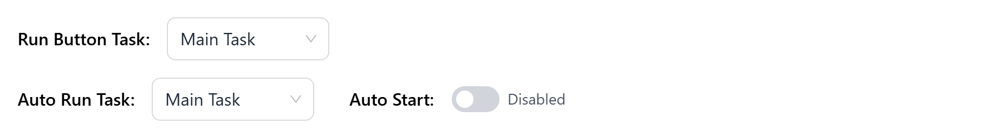
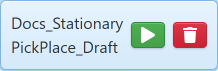

# DeltaXStudio — Daily Operation

Use this guide for an application that has already passed its setup and picking tests. For a new installation or an untested application, start with [Pick & Place setup](overview.md#the-pick-place-setup-path).

## Open the configured system

Power on the installation using its normal startup procedure and wait for the controller to start. Connect your computer or tablet to the robot's network, then open `http://<Local IP>:3000` using the robot's current address and the port configured for your installation.

If the address no longer works, check the current IP in your router or through the robot's access point. See [System Setup](../deltaxstudio.md#if-you-cannot-connect) for connection troubleshooting.

If Auto Start is enabled, the configured task may start without pressing Run. Keep the work area clear during power-up and check the displayed task state before issuing another start command. Disable Auto Start and save before returning to setup or editing the application.

## Check readiness

Use Dashboard and the camera preview to confirm the setup still matches the application you tested:

- The intended robot and required devices are connected, with no unresolved stop or error state.
- The tool, object supply, and place destinations are ready, and the working area is clear.
- For camera-based applications, the image, lighting, and detection crop are correct. Test objects have the expected detection and class.
- For conveyor tracking, the encoder responds to belt movement in the expected direction.
- The intended model, parameters, and saved task are selected.

Calibration and AI training are setup activities; do not repeat them solely because the controller was restarted. If equipment moved or the application changed, use [When the application changes](overview.md#when-the-application-changes) to find the checks to repeat.

<figure class="studio-figure" markdown="1">

<figcaption>Use the indicators to check required devices. Green shows a connection; gray devices in this example are disconnected.</figcaption>
</figure>

## Start the application

Use the start control that belongs to your tested setup:

| Application | How to start |
| --- | --- |
| Built-in picking with AI | Confirm the configured detection is working. Check that Run Button Task is Main Task, then use Dashboard Run. |
| Built-in picking with a Blockly vision task | Start the saved vision-only task and verify its preview, then start Main Task. |
| Custom Blockly movement or combined vision/movement | Use the saved task's play button, select the intended robot, and click Run Task. |
| Configured automatic startup | Confirm the intended task is already running before starting anything manually. |

The header Run button executes Run Button Task. Opening a program in the editor does not select it for that button. Do not start Main Task alongside a custom movement task for the same robot.

Observe the first objects through detection, pickup, transfer, and release before continuing normal operation. If the result differs from the tested setup, stop and check the cause before increasing speed or supply.

<figure class="studio-figure" markdown="1">

<figcaption>Check Run Button Task before using the header Run control. Auto Run Task is the separate power-up selection.</figcaption>
</figure>

<figure class="studio-figure" style="max-width:280px" markdown="1">

<figcaption>For a custom application, use the play button on its saved-task card. This stationary task name is an example.</figcaption>
</figure>

## Stop and make adjustments

Use the normal task Stop control to end a run. For a custom task, use its stop button in Saved Tasks. Stop an externally controlled conveyor using its own controls, and confirm the required equipment has stopped before intervening.

Before changing parameters or blocks, stop the affected task. Save settings or update the program, wait for confirmation, and repeat a controlled test before returning to normal operation. See [Blockly Programming](blockly.md#check-and-save) for program updates.

If immediate intervention is required, use the physical emergency stop. Clear the cause and verify the robot state before resuming operation. If using Termite for recovery, follow [Emergency stop and recovery](../termite.md#7-emergency-stop-and-recovery); a resume command does not confirm the robot's position or home it.

## Find the right troubleshooting guide

| Symptom | Where to check |
| --- | --- |
| The interface does not open | [Connection checks](../deltaxstudio.md#if-you-cannot-connect) |
| Objects are missing, duplicated, or assigned the wrong class | [Vision](vision.md): open the method in use and its troubleshooting section |
| Picks consistently miss or objects fail to grip/release | [Picking and release errors](pick_and_place.md#correct-picking-and-release-errors) |
| A saved task cannot run or reports a block error | [Blockly troubleshooting](blockly.md#if-the-program-does-not-work) |
| The wrong task starts after power-up | [Automatic startup settings](pick_and_place.md#enable-automatic-startup) |
| Alignment changed after moving equipment | [Calibration](calibration.md), followed by detection and picking checks |
