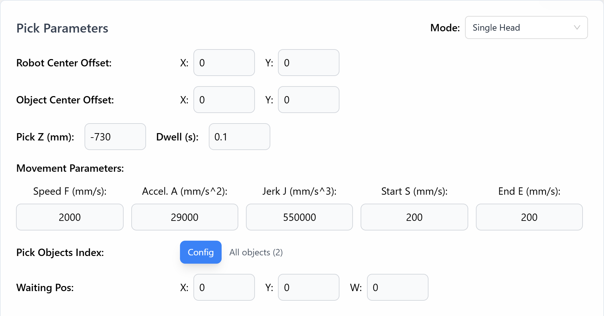
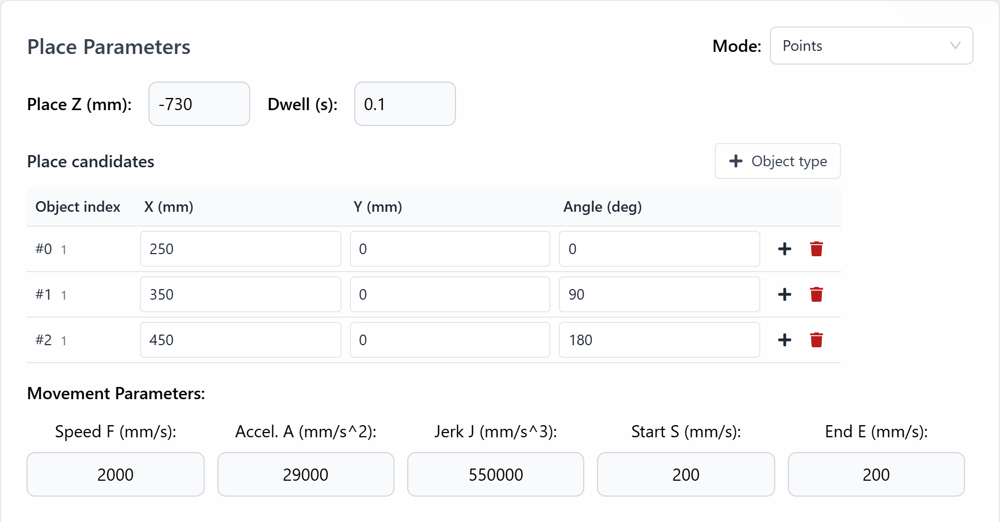
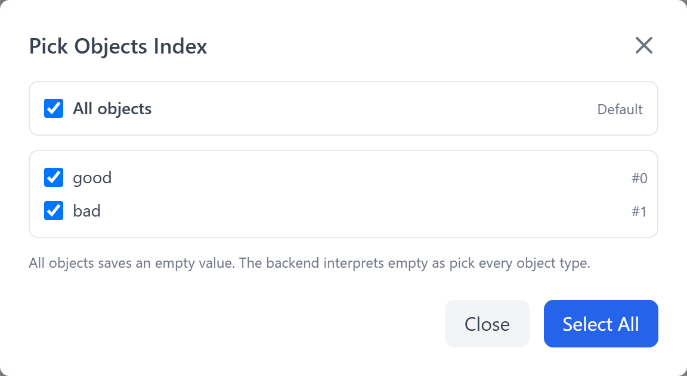
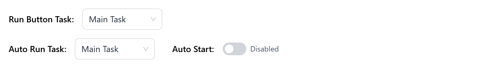
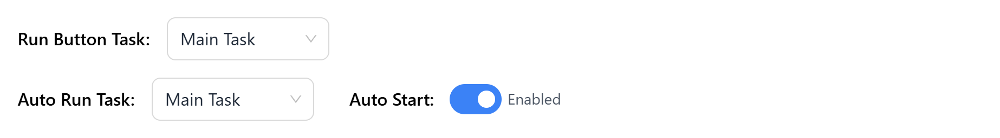

# DeltaXStudio — Pick & Place

Complete [Calibration](calibration.md) and verify [Vision](vision.md) before running the robot automatically. Choose how the robot will move first: built-in Main Task or your own Blockly program. Then configure that task and test one object.

## Choose how to run the system

Vision supplies tracked objects; the movement task decides how the robot picks and places them. Choose the movement method that fits your application.

### Built-in Main Task

Use the supplied picking behavior. Set heights, object selections, and destinations in Settings → Parameters.

[Configure built-in picking →](#configure-the-pick-and-place-parameters)

### Blockly movement program

Define the sequence, poses, heights, and tool actions in blocks. Start with a saved example and adapt it to your application.

[Choose a movement example →](#create-and-run-a-movement-program)

Use the row below that matches your [detection method](vision.md#choose-your-detection-method) and movement choice:

| Detection | Movement | How to start |
| --- | --- | --- |
| AI, with or without Template Matching | Built-in pick and place | Enable and test the configured detection, select Main Task for Run Button Task, then click Run. |
| AI, with or without Template Matching | Movement blocks | Enable the configured detection, then run the saved movement task for the intended robot. |
| Color filtering, with or without a Match With Template block | Built-in pick and place | Disable Vision AI. Run the vision-only task and check detection, then start Main Task. |
| Color filtering, with or without a Match With Template block | Movement blocks | Disable Vision AI. Save and run one program containing both parts; follow [Color filtering + pick & place](blockly/color-pick-and-place.md). |

The header Run button executes the task selected in Run Button Task. When starting a custom movement task from Saved Tasks, do not also start Main Task for the same robot.

### Create and run a movement program

Use [Blockly Getting started](blockly.md) if you are new to the editor. Then choose the program that matches your task:

| Program | Use it for |
| --- | --- |
| [Stationary pick & place](blockly/stationary-pick-and-place.md) | One pick and place at entered fixed positions. |
| [Conveyor pick & place (AI)](blockly/conveyor-pick-and-place.md) | Picking AI-detected objects with encoder tracking. |
| [Color filtering + pick & place](blockly/color-pick-and-place.md) | Detecting by HSV and running the picking loop in one task. |
| [Sort two object types (AI)](blockly/sort-two-types.md) | Sending two AI classes to separate destinations. |

Follow the selected example for tool setup, position and height inputs, checking, saving, and running on the intended robot. Enter the movement values in its blocks. For camera-based picking, complete calibration and check the configured Robot Pick Area before testing.

After the program passes its picking tests, continue with [Daily Operation](daily_operation.md). The parameter and destination sections below describe the built-in Main Task.

## Configure the pick and place parameters

For built-in Main Task, open Settings → Parameters. If there are multiple robots, select the robot whose parameters you want to edit.

| Setting | What to enter |
| --- | --- |
| Pick Parameters → Pick Z (mm) | The tool height at which the object is picked, in robot coordinates. |
| Pick Parameters → Dwell (s) | The time allowed for the end effector to grip the object before lifting. |
| Place Parameters → Place Z (mm) | The tool height at which the object is released. |
| Place Parameters → Dwell (s) | The time allowed for release before moving away. |
| Other Parameters → Travel Z (mm) | The transfer height between pick and place, with clearance for the object, fixtures, and destination. |
| Motion parameters | Feedrate F in mm/s, acceleration A in mm/s², jerk J in mm/s³, and start/end speeds S/E in mm/s. Keep start/end speeds within the selected feedrate. |
| Robot Pick Area | The part of the tracked working area assigned to this robot. |

Pick Z, Place Z, and Travel Z are absolute robot-coordinate heights. Determine them for the installed tool and object; values from another robot or a sample program may not fit your machine.

Check the end-effector type and output configuration in Settings → System. Save the parameter changes and wait for the saved confirmation before running.

<figure class="studio-figure" markdown="1">

<figcaption>Set pickup height, grip dwell, and motion for the installed robot and tool. Use measured values rather than copying the screenshot.</figcaption>
</figure>

<figure class="studio-figure" markdown="1">

<figcaption>Travel Z is an absolute transfer height in robot coordinates. Conveyor Z records the measured belt surface.</figcaption>
</figure>

<figure class="studio-figure" markdown="1">

<figcaption>Configure the tracked picking region assigned to this robot and check it against the calibrated workspace.</figcaption>
</figure>

## Assign object types to place destinations

For built-in Main Task, start with the point-based place mode and configure Place candidates under Place Parameters.

Match each Object index to the class order in Vision AI Objects: index `0` is the first class, index `1` the second. Enter the destination X, Y, and Angle for each class you want to place.

Use + Object type to add another class. The plus button on a row adds another candidate destination for that same class.

<figure class="studio-figure" markdown="1">

<figcaption>Each Object index has its own destination candidates. Add only indices used by your model and enter reachable positions for your installation.</figcaption>
</figure>

Under Pick Objects Index → Config, select the classes this robot should pick. Save and verify the class-to-destination mapping using one object from each selected class.

<figure class="studio-figure compact" markdown="1">

<figcaption>Choose which trained classes may be picked. All objects includes every class; the names shown are examples.</figcaption>
</figure>

To skip a class, exclude it from the pick selection. In point-based placement, an object without a valid place candidate is also skipped. Preserve the other class indices when removing candidates; do not remove a class name from the Vision AI Objects list to skip it.

An empty Pick Objects Index setting means all classes. Do not use an empty setting as a way to disable picking.

## Make the first pick

Use this procedure for built-in Main Task. For a Blockly task, follow the run procedure in its selected example.

Confirm that calibration is complete, the intended model or vision program is active, and the camera recognizes a test object correctly. Check the pick height, transfer clearance, destination, and end-effector operation.

1. Open Settings → System → System Control. Set Run Button Task to Main Task and save. Return to Dashboard and click Run to start the built-in pick-and-place task.
2. For a conveyor setup, start the conveyor at a low test speed and introduce one object. Observe the pick, transfer, and release.
3. Stop the task before adjusting parameters. Repeat with each object class and several positions before increasing throughput.

Use the normal task Stop control to end a test. If immediate intervention is required, use the physical emergency stop.

<figure class="studio-figure" markdown="1">

<figcaption>Select Main Task for Run Button Task during the built-in picking test. Keep Auto Start Disabled while commissioning.</figcaption>
</figure>

## Correct picking and release errors

### The tool consistently misses by the same amount

Open Settings → Parameters → Pick Parameters → Robot Center Offset. Apply the correction in robot X/Y coordinates.

For example, if the tool is consistently `5 mm` too far in negative X and `3 mm` too far in positive Y, the required correction is `+5 mm` in X and `−3 mm` in Y. Add this correction to the current offset, save, and test again.

Use Object Center Offset when the desired grip point is displaced from the detected object center and that displacement should follow the object's rotation. Leave it at zero when picking at the detected center.

If the error changes with conveyor speed, object position, or rotation, check tracking, calibration, and orientation first. A fixed Robot Center Offset cannot correct all of those errors.

### The tool reaches the object but does not hold it

Check Pick Z, tool contact, vacuum or gripper operation, and the configured output. If the tool needs more time to grip, increase Pick Parameters → Dwell (s) gradually. Keep the delay only as long as needed for reliable pickup.

### The object is still attached when the robot leaves

Check the release output and tool operation. Increase Place Parameters → Dwell (s) if the object needs more time to release before the robot moves away.

### A detected object is not picked

Check that its class is included in Pick Objects Index, it has a valid destination, it enters Robot Pick Area, and the selected task is running on the intended robot. For vision blocks, also check that detections reach Push To Tracking Manager.

## Enable automatic startup

Enable automatic startup only after the selected task has passed manual tests with the installed hardware and workspace clear.

Open Settings → System → System Control. Set Auto Run Task to Main Task or the saved program that should start after power-up. Enable Auto Start, then save and wait for confirmation.

<figure class="studio-figure" markdown="1">

<figcaption>Enable Auto Start only after manual tests pass. Auto Run Task selects the startup program; Run Button Task controls the header button.</figcaption>
</figure>

Test a controlled restart with the work area clear. The controller attempts automatic startup approximately 15 seconds after its application starts, subject to its connection and run-state checks.

Auto Run Task is separate from Run Button Task. Check both selections. A custom automatic-start task is dispatched to the configured robots, so verify the program is suitable for every target in a multi-robot installation. Turn Auto Start off and save before returning to setup or changing the application.

## Setup complete

The setup is ready for routine operation when low-speed tests reliably pick, transfer, and release each selected object class at several positions. For conveyor applications, verify tracking as well. Continue with [Daily Operation](daily_operation.md) for normal startup, checks, and stopping.

To customize the application, use [Blockly Programming](blockly.md). This is optional when the built-in task meets your needs.
