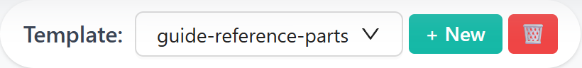
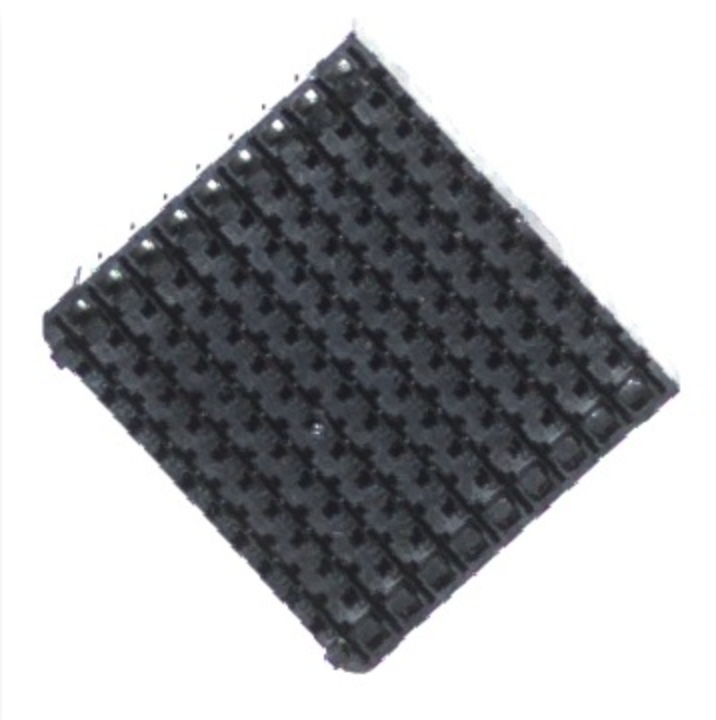
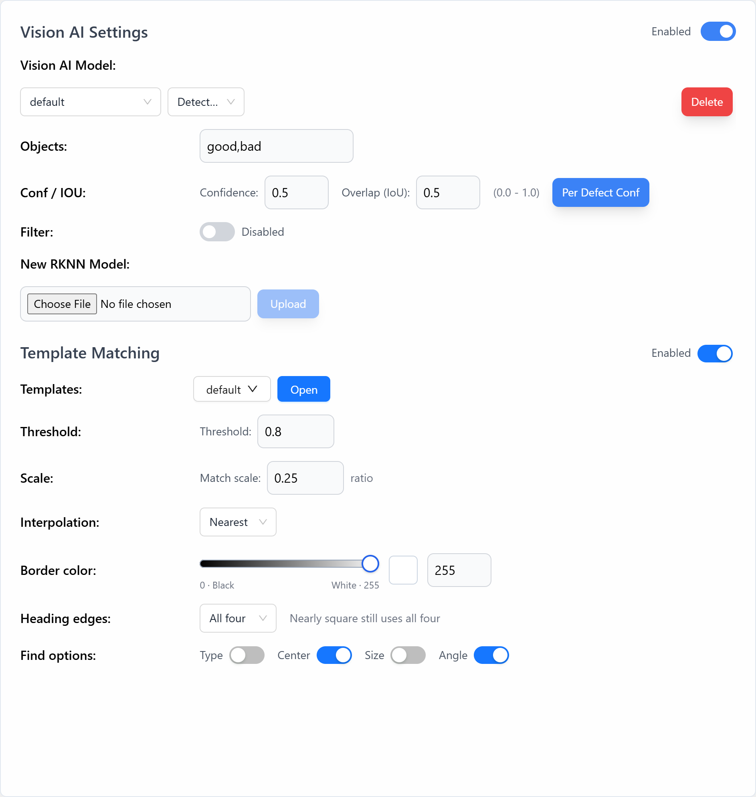

# Vision — AI + Template Matching

Vision · AI + Template Matching

[Change method](../vision.md)

Use AI to find candidate objects, then compare them with reference templates to refine detections and reject unwanted shapes.

<!-- Keep links to the former shared AI sections reachable at the AI prerequisite below. -->

Start with a working AI detector. Image capture, labeling, training, model upload, and activation use the shared [AI guide](ai.md).

- Need a model? Follow [Capture, label, and train](ai.md#capture-and-download-images-in-deltaxstudio).
- Already have an RKNN file? [Upload and enable it](ai.md#upload-and-enable-the-model-in-deltaxstudio), then [verify AI detection](ai.md#verify-detection-before-picking).
- AI detection already works? Continue with the template steps below. Keep movement tasks stopped while configuring and checking detection.

## Prepare the reference templates

Capture templates with the same camera, detection crop, lighting, and object height used during operation.

In DeltaXStudio, open Vision and select Template Matching mode. Create or select a template folder. In Images, select Cropped, open the live camera, place a representative object, and click Save Current Image.

<figure class="studio-figure" style="max-width:500px" markdown="1">

<figcaption>Choose or create a reference-image folder in Template Matching mode. The pictured folder name is an example.</figcaption>
</figure>

Open Crop and select the saved image. Draw a tight rectangle containing the complete object, with minimal surrounding background. Click Crop & Save. This replaces that saved image with the cropped template; keep training images in their separate AI project.

<!-- Add the user-provided Crop selection screenshot here: images/tutorials/control_guides/DeltaXStudio/vision/template-crop.png. -->

Repeat for the required reference objects. Inspect the folder contents and remove unsuitable captures before using it. Save/apply the configuration and restart the relevant vision task after changing templates. Reset the system if it is still using a previously loaded template set.

Check the resulting object index whenever templates supply the type. Template indices follow the loaded filename order, starting at `0`; they are not automatically matched to AI class names. Keep a clear mapping from each index to its pick filter and place destination, and recheck it after adding or renaming templates.

An empty template folder cannot validate candidates. Confirm the saved cropped images are present before testing this workflow.

<figure class="studio-figure" style="max-width:240px" markdown="1">

<figcaption>Example cropped template: keep the full outline and minimize surrounding background.</figcaption>
</figure>

## Enable template refinement

Use AI to find candidate objects, then match reference images around those candidates. Template Matching can update the center, size, angle, or type and reject candidates without an acceptable match.

Open Settings → System → Vision AI Settings. Keep Vision AI enabled, then enable Template Matching. Select the folder under Templates. Click Open to check its images.

Adjust Threshold, Scale, and Find options for the result you need.

Save and apply the settings, then inspect the final detections in Dashboard. Compare object center, angle, and class with AI-only results.

<figure class="studio-figure" markdown="1">

<figcaption>For AI + Template Matching, enable both switches. Select your reference-template folder and refinement options, then click Save System. The values shown are examples.</figcaption>
</figure>

| Setting | Effect |
| --- | --- |
| Threshold | Minimum accepted template-match score. A stricter value can reject incorrect matches but can also remove valid candidates. |
| Scale | Image reduction used during matching. For example, `0.25` means matching at one-quarter image dimensions. It does not mean the physical object is one-quarter size. |
| Type | Replace the AI class with the matched template index. Leave this off when you want to preserve AI classes. |
| Center | Use the matched template center as the object position. |
| Size | Use the matched template dimensions. |
| Angle | Use the matched template direction. |

For rotating parts, use an AI label type that provides a useful candidate orientation, such as ORI. The current refinement checks the candidate direction and its opposite; verify the expected angle range instead of assuming an unoriented AI box can provide every rotation.

If enabling Template Matching makes valid detections disappear, check the selected folder, crop, object scale, and threshold. Verify that the final object indices still correspond to the intended destinations, especially with Type enabled.

## Verify detection before picking

Keep movement tasks stopped and compare the combined result with the AI-only preview:

- Intended objects remain detected, while unwanted shapes fail the template check.
- Each accepted object has one stable detection with the expected center and orientation.
- Final object indices match the pick filters and destinations, especially when Type refinement is enabled.

Test the positions and rotations expected during operation. Once the refined detections are reliable, continue to [Pick & Place](../pick_and_place.md#4-choose-how-to-run-the-system) and test one object at low speed.

## If detection does not work

| Problem | What to check |
| --- | --- |
| All candidates disappear after matching | Selected template folder, saved images, object scale, candidate direction, and threshold. |
| Good objects are rejected | Template crop and lighting; reduce the threshold gradually while checking unwanted matches. |
| Incorrect center or angle | Template alignment, AI candidate orientation, and the enabled Center/Angle options. |
| Unexpected final type | Type refinement and template filename order; recheck the destination mapping. |

For missing or incorrect AI detections before template refinement, use [AI troubleshooting](ai.md#if-detection-does-not-work).
