# Vision — AI

Vision · AI

[Change method](../vision.md)

Capture images in DeltaXStudio → label and train in [DeltaXHub](https://deltaxhub.com) → upload RKNN → verify detection.

Before starting: complete [Calibration](../calibration.md), check the live camera and lighting, and keep robot movement stopped.

- Already have an RKNN model? Go to [Upload and enable the model](#upload-and-enable-the-model-in-deltaxstudio), then verify detection.
- Need to train a model? Start with [Capture and download images](#capture-and-download-images-in-deltaxstudio) below. Labeling and training require a DeltaXHub account and Internet access.

## From camera images to a working model

Use DeltaXStudio for image capture and robot-side detection. Use AI Hub on [deltaxhub.com](https://deltaxhub.com) for labeling and training.

| Stage | What you should have before continuing |
| --- | --- |
| [Capture and download](#capture-and-download-images-in-deltaxstudio) DeltaXStudio | A downloaded project ZIP, extracted to an `images` folder on your computer. |
| [Upload and label](#upload-images-and-create-classes) AI Hub | Images uploaded, classes defined, and every target object labeled and reviewed. |
| [Train](#configure-and-start-training) AI Hub | A completed training run for that server project. |
| [Download the model](#review-results-and-download-rknn) AI Hub | The trained `.rknn` file and its class names in model order. |
| [Upload and activate](#upload-and-enable-the-model-in-deltaxstudio) DeltaXStudio | The uploaded model selected, matching model type and classes entered, and settings saved. |

Keep the robot's DeltaXStudio address available. Your computer needs Internet access for DeltaXHub and a connection to the robot's network when you return to upload the model. See [System Setup](../../deltaxstudio.md) if the robot is still only accessible through its hotspot.

## Capture and download images in DeltaXStudio

### Create an image project

Open the robot's DeltaXStudio interface and select Vision in the sidebar. Set Mode to Vision AI.

Beside the Project selector, click + New. Enter a descriptive name, such as `sorting-parts`, then click the check mark or press Enter. Confirm that the new name is selected. To add images to an existing collection, select that project instead.

Open the Images tab. These images are stored on the robot controller; download them to your computer before uploading them to AI Hub.

<figure class="studio-figure" style="max-width:420px" markdown="1">

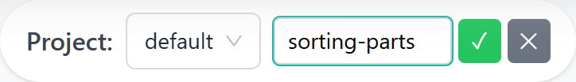

<figcaption>Click + New, enter a project name, and confirm with the check mark. This example enters sorting-parts.</figcaption>
</figure>

### Capture representative images

In the right-hand Camera Controls panel, check that the camera is connected. Set Image Type to Cropped, then click Open Live Camera. Check that the preview shows the calibrated detection area used during operation.

Place objects in the detection area and click Save Current Image. Confirm that a new image appears in the list. Change the objects' positions, rotations, and spacing before capturing the next frame. Include every class and the lighting, backgrounds, and object arrangements expected during operation.

<figure class="studio-figure block-detail" markdown="1">

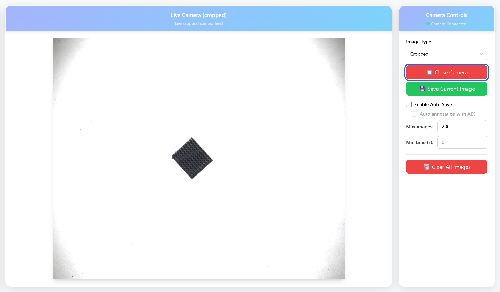

<figcaption>Select Cropped and open the live camera, then use Save Current Image to collect each frame. The object shown is an example.</figcaption>
</figure>

Review the saved images. Remove blurred captures, accidental duplicates, and unusable frames; check that one class or one pose does not dominate the dataset. Around 100 varied images can be a starting collection, rather than a fixed requirement. Keep some fresh captures for testing the finished model.

Optional: capture a series with Auto Save

With the live camera open, set Max images to the number of frames to collect and Min time (s) to the interval between saves. Enable Enable Auto Save while changing the scene between captures.

<figure class="studio-figure portrait" markdown="1">

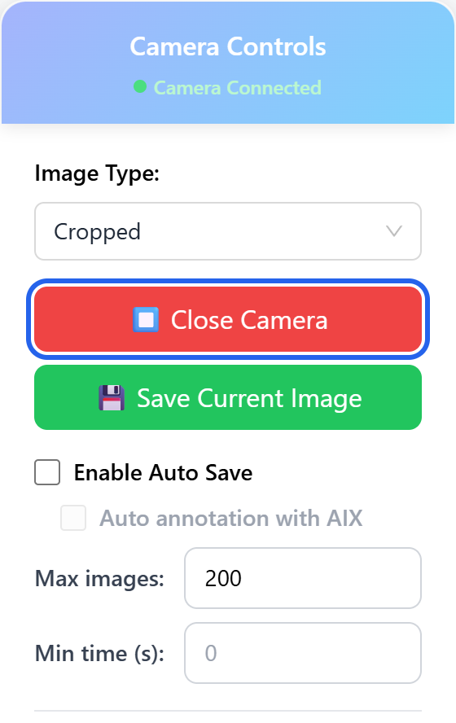

<figcaption>Set the capture limits before enabling Auto Save. Leave automatic AIX annotation off for the first dataset.</figcaption>
</figure>

Leave Auto annotation with AIX off when preparing the first dataset. This guide labels the images in AI Hub. Turn Auto Save off when finished and review the collection before downloading it.

### Download and extract the images

Close the live camera when capture is complete. Check the selected project, then click the download icon beside it, labeled Download project. Save the downloaded ZIP to your computer.

<figure class="studio-figure" style="max-width:360px" markdown="1">

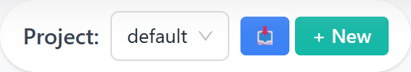

<figcaption>Download the selected project with the icon immediately before + New, then extract its ZIP on your computer.</figcaption>
</figure>

In Windows, right-click the ZIP and choose Extract All. Open the extracted folder, then its images folder, and check that your captured images are present and readable.

In the AI Hub steps below, upload the image files inside this folder. The project ZIP may also contain a `labels` folder; the image-upload button expects the images, not the ZIP or that labels folder.

## Create a server project in DeltaXHub

Open [deltaxhub.com](https://deltaxhub.com) and sign in. Select AI Hub → Projects → Create Project.

Enter a descriptive project name and select Storage: Server. Server storage is required for the training workflow below. Local storage is for labeling and exporting data to train elsewhere.

Choose the project's label type using the table below. Leave Public off unless you intend to share the project. Click Create, then Open on the new project card.

This is a separate project in DeltaXHub. Using the same name as the DeltaXStudio image project makes it easier to identify, but the images are transferred by the upload below.

<figure class="studio-figure" markdown="1">

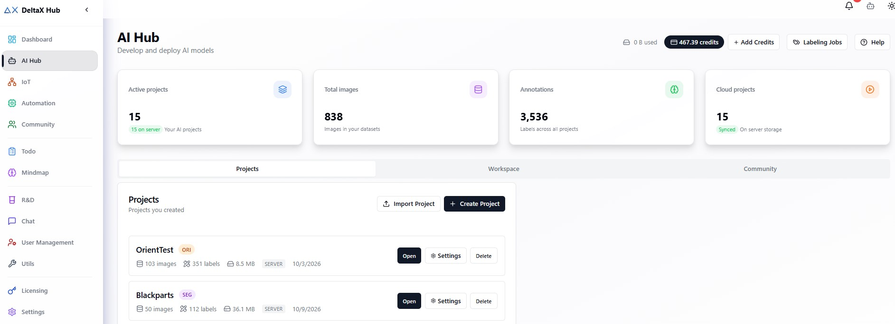

<figcaption>Open AI Hub and create a project.</figcaption>
</figure>

<figure class="studio-figure portrait" markdown="1">

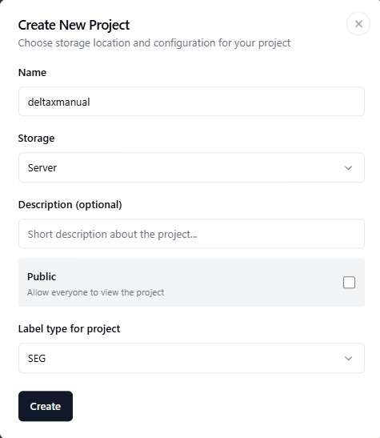

<figcaption>Select Server storage and the label type required by your application.</figcaption>
</figure>

| DeltaXHub label type | Meaning | DeltaXStudio model type |
| --- | --- | --- |
| RECT | A rectangular bounding box for locating an object without orientation. Suitable for simple position-based picking, such as round fruit. | DET |
| ORI | An oriented bounding box for an object whose rotation matters. Label its direction consistently. | ORI |
| SEG | A polygon or mask describing the object boundary, useful when the outline is important. | SEG |

The project label type describes the annotation format. Classes describe the object categories, such as `class_A` and `class_B`; create one class for each category the robot must distinguish.

<figure class="studio-figure" markdown="1">

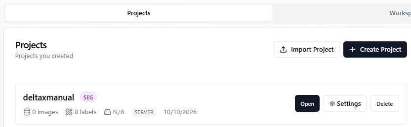

<figcaption>Open the newly created project to upload images and add labels.</figcaption>
</figure>

## Upload images and create classes

In the open AI Hub project, click the plus button in the left Images panel. Browse to the extracted images folder, select the captured image files, then click Open. Wait for the upload to finish and confirm the images appear in the list. Select one to check that the correct camera images were uploaded.

In the right Classes panel, click plus to add the classes you need. Give them clear, consistent names. Check the class list and order before labeling. Keep a record of that order for the Objects setting on the robot.

<figure class="studio-figure" markdown="1">

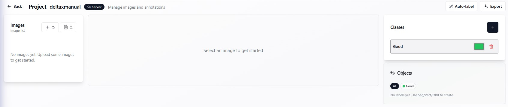

<figcaption>Upload captured images on the left and define object classes on the right.</figcaption>
</figure>

## Label and review every image

With an image and its intended class selected, draw a rectangle, oriented box, or segmentation outline around each target object according to the project’s label type. Check the Objects list. Correct the class of any mislabeled object and remove unwanted annotations.

SAM can assist with every project label type: RECT, ORI, or SEG. It starts disabled. After selecting an image, enable SAM near the top of the editor and wait for it to become ready. First use on a new computer may take longer while the required files download. SAM needs a supported, sufficiently capable GPU; if it is unavailable, continue labeling manually.

Review and correct every assisted annotation, including its box or outline, orientation where applicable, and assigned class. SAM assistance does not replace this review.

Repeat for the remaining images. Review all visible target objects, including rotated or difficult examples, before starting training. Confirm the annotations are retained when you revisit an image, then click Back to leave the editor.

<figure class="studio-figure" markdown="1">

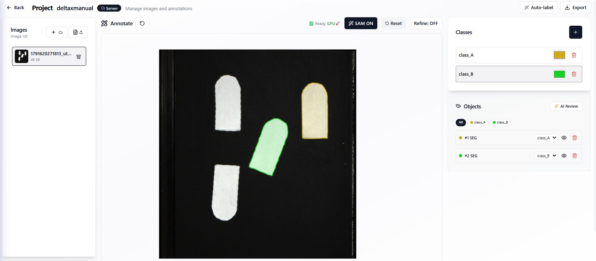

<figcaption>Annotation in progress: review each outline and class, then label the remaining target objects.</figcaption>
</figure>

For ORI, keep the object's reference direction consistent across images. For SEG, follow the actual boundary instead of including large areas of background. Assisted labeling still needs review; a plausible-looking outline can belong to the wrong class or miss part of the object.

## Configure and start training

Find your server project in AI Hub’s Workspace tab and check its image and class counts. Click Train, or Retrain for a project with previous training runs.

In the training dialog, select AIX New. Review Auto Configuration, or open Customize Settings to adjust the parameters.

Review the displayed cost information and available credits, then click Start Training. Wait for the queued job to run and reach Completed. A queued job has not yet finished training.

<figure class="studio-figure" markdown="1">

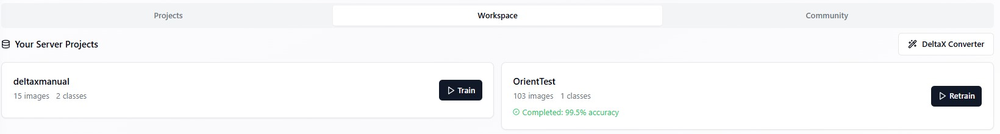

<figcaption>Start training from the project's Workspace card.</figcaption>
</figure>

<figure class="studio-figure portrait" markdown="1">

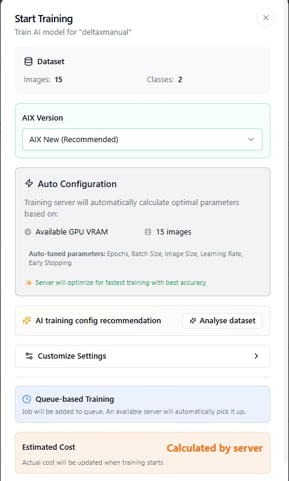

<figcaption>Review the dataset, training configuration, and current cost information.</figcaption>
</figure>

Optional: custom training parameters

| Parameter | What it controls |
| --- | --- |
| Epochs | The maximum number of passes through the training dataset. More epochs take longer and do not automatically improve results. The supplied example uses 100. |
| Batch Size | Images processed together in each training step. Choose a value that fits the dataset and training server memory; a larger batch is not inherently more accurate. |
| Image Size | Input resolution for training. The example uses 640 px. Higher resolution can retain small details but requires more resources. |
| Learning Rate | The size of the model's update steps. Start with the offered default unless you have a reason to change it. |
| Early Stopping Patience | The number of epochs without sufficient improvement before training stops early. |

<figure class="studio-figure portrait" markdown="1">

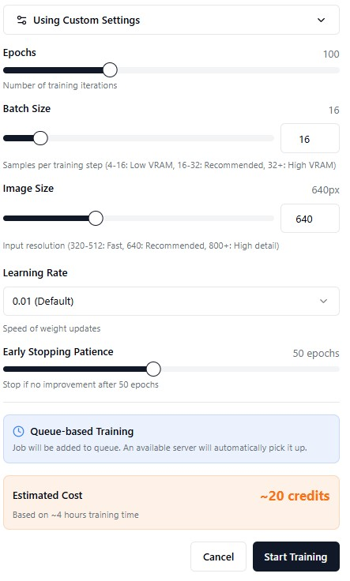

<figcaption>Example custom settings. Training time and credit estimates depend on the selected job.</figcaption>
</figure>

Improve dataset coverage and annotation quality before simply increasing epochs or image count. Inspect performance on fresh images as well as the reported training results.

## Review results and download RKNN

Open the project's training details and select the completed run in Training History. Inspect the training curves, class results, and confusion matrix. Check both missed objects and false detections; a high summary score alone does not verify the robot's working conditions.

Scroll to the downloads for that completed run. Click RKNN (best.rknn) and save the `.rknn` file on your computer. Keep it with the project name, label type, class names in model order, and training run. You will need this file and class order in DeltaXStudio.

<figure class="studio-figure" markdown="1">

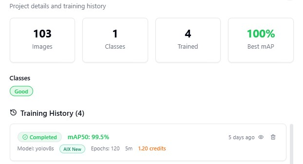

<figcaption>Select a completed run to inspect its results.</figcaption>
</figure>

<figure class="studio-figure" markdown="1">

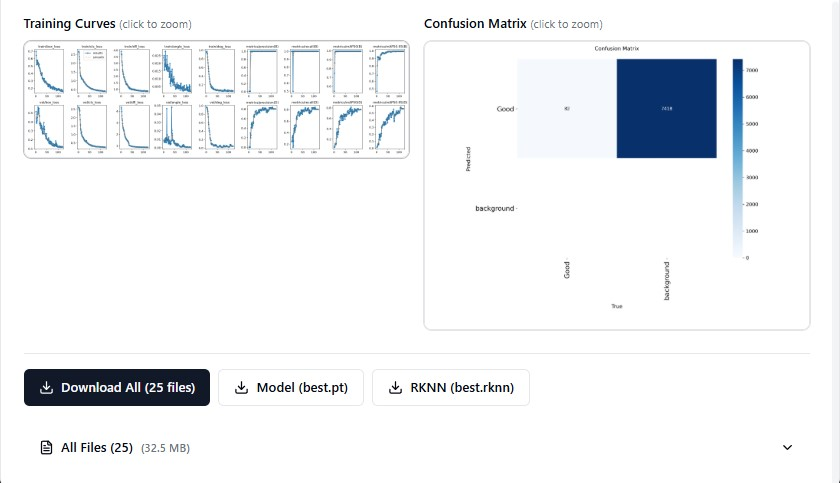

<figcaption>Download the RKNN model for upload to DeltaXStudio.</figcaption>
</figure>

The Model (best.pt) download is a different format. For DeltaXStudio's New RKNN Model upload, use the `.rknn` file.

## Upload and enable the model in DeltaXStudio

Reconnect your computer to the robot's network and open DeltaXStudio at its current IP address and web port, normally `http://<robot-ip>:3000`. Keep movement tasks stopped while uploading and checking the model.

1. Open Settings → System → Vision AI Settings. At New RKNN Model, click Choose File, select the downloaded `.rknn` file, and click Upload. Wait for the upload-success message.
2. Select the uploaded model in Vision AI Model. Select its matching type in the adjacent dropdown: RECT → DET, ORI → ORI, or SEG → SEG.
3. In Objects, enter all class names in the trained model's order, separated by commas. For example, enter `class_A,class_B` for a model whose classes are class_A at index 0 and class_B at index 1. Do not add a trailing comma.
4. Set the switch beside the Vision AI Settings heading to Enabled. For AI-only operation, leave Template Matching disabled. Click Save System at the top right and wait for confirmation. Uploading the file alone does not select or activate it.
5. Return to Dashboard, open the camera view, and place a test object in the detection area. Check its class, center, and orientation before starting a movement task. If the new configuration has not taken effect after saving, use System Control → Reset, wait for reconnection, and check again.

<figure class="studio-figure" markdown="1">

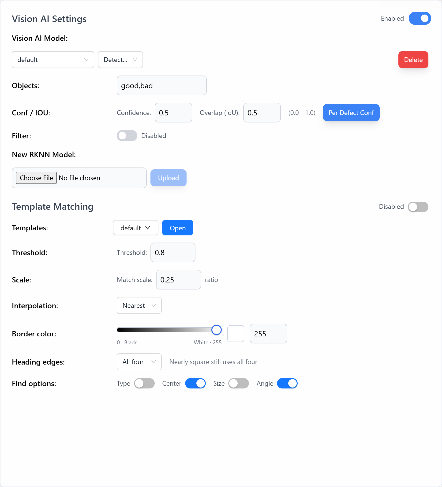

<figcaption>Vision AI is Enabled and Template Matching is Disabled. Select your model, type, and classes, then click Save System. The pictured model and good,bad class names are examples.</figcaption>
</figure>

Class index `0` corresponds to the first Objects entry, index `1` to the second, and so on. Keep every model class in this list even when a class should not be picked. Configure that selection under [Pick Objects Index](../pick_and_place.md#2-assign-object-types-to-place-destinations).

Conf and IOU use values from `0` to `1`. Start with the provided IOU default. Increasing Conf removes lower-confidence predictions, which can also remove valid objects; it does not improve the model itself. Change one setting at a time and inspect the live result.

## Verify detection before picking

Keep movement tasks stopped while checking the camera preview:

- Each class is detected at the positions, rotations, spacing, and partial occlusion expected during operation.
- Each object has one stable detection with the correct center, orientation, and class index.
- The empty background produces no false detections.

Once detection is reliable, continue to [Pick & Place](../pick_and_place.md#4-choose-how-to-run-the-system) and start with one object at a low test speed.

To refine AI detections with reference images, continue with [AI + Template Matching](ai-template.md#prepare-the-reference-templates) before testing picking.

## If detection does not work

| Problem | What to check |
| --- | --- |
| Save Current Image is unavailable | Camera connection, Open Live Camera, and a live frame in the preview. |
| Captures are missing from the download | Selected DeltaXStudio project and the extracted ZIP's `images` folder. |
| Project is missing from training | Server storage, completed image uploads, and the correct project in AI Hub Workspace. |
| Wrong model file selected | Download RKNN from the completed run and upload the `.rknn` file. |
| Uploaded model is not active | Vision AI Model selection, matching type, main enable switch, and Save System confirmation. |
| No AI detections | Model upload, enabled state, model type, camera crop, and Conf threshold. |
| Swapped classes | Trained class order and the Objects list. |
| Training results look good but real objects fail | Fresh operating images, lighting, and annotation quality. |
