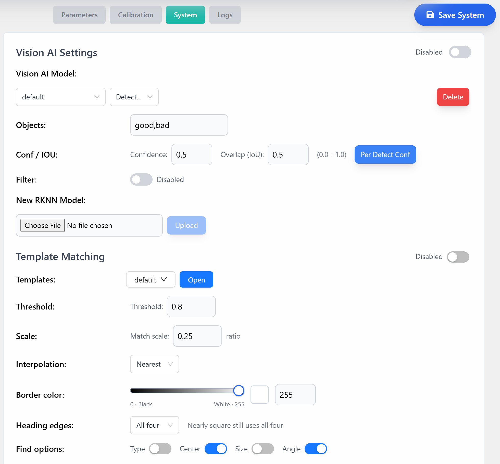
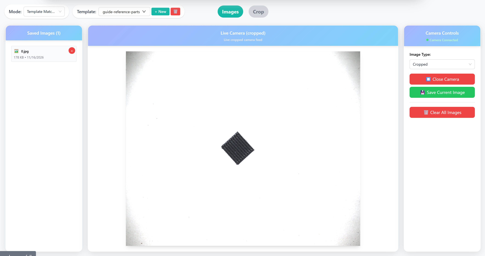
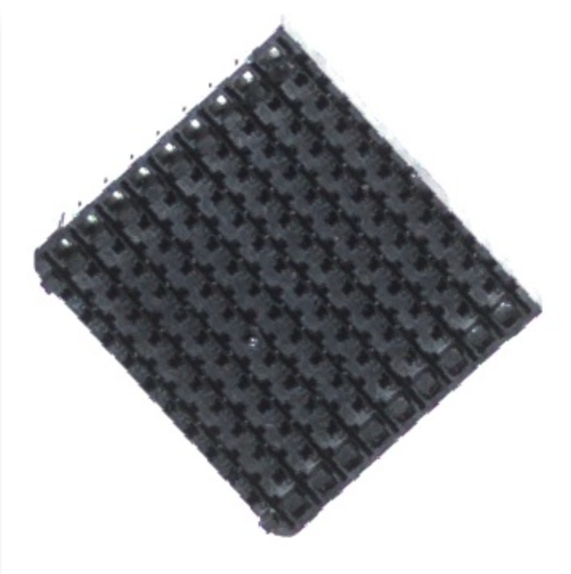
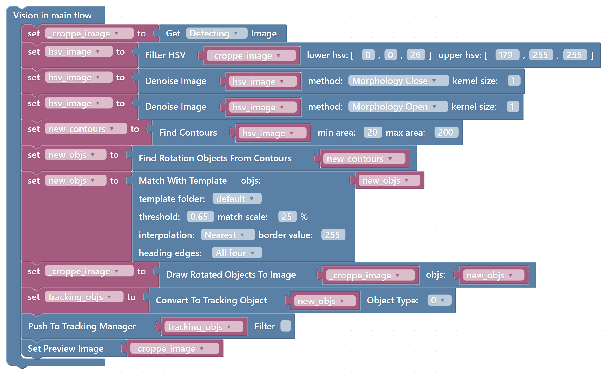

# Vision — Color filtering + Template Matching

Vision · Color filtering + Template Matching

[Change method](../vision.md)

Separate objects by color → find contours → match reference templates → send the final objects to tracking. No AI training is required.

Before starting: complete [Calibration](../calibration.md), check the live camera and lighting, and keep robot movement stopped. The object color must be distinguishable from the background.

New to the editor? See [Blockly](../blockly.md) for creating, checking, saving, and running a task. The pipeline for this detection method is described below.

## Prepare the color-detection task

Disable Vision AI and the System Template Matching switch. Save and apply the settings. Stop any previous vision task before running its replacement.

<figure class="studio-figure" markdown="1">

<figcaption>Keep both system switches Disabled. This workflow performs detection in Blockly.</figcaption>
</figure>

Open Programs and create a Blockly task with Vision in main flow.

## Prepare the reference templates

Capture templates with the same camera, detection crop, lighting, and object height used during operation.

In DeltaXStudio, open Vision and select Template Matching mode. Create or select a template folder. In Images, select Cropped, open the live camera, place a representative object, and click Save Current Image.

<figure class="studio-figure block-detail" markdown="1">

<figcaption>Capture a representative object into your template folder using Cropped camera images.</figcaption>
</figure>

Open Crop and select the saved image. Draw a tight rectangle containing the complete object, with minimal surrounding background. Click Crop & Save. This replaces that saved image with the cropped template. Use separate captures if you also need to keep the full frames.

<!-- Add the user-provided Crop selection screenshot here: images/tutorials/control_guides/DeltaXStudio/vision/template-crop.png. -->

Repeat for the required reference objects. Inspect the folder contents and remove unsuitable captures before using it. Save/apply the configuration and restart the relevant vision task after changing templates. Reset the system if it is still using a previously loaded template set.

Check the resulting object index whenever templates supply the type. Template indices follow the loaded filename order, starting at `0`; they are not automatically matched to AI class names. Keep a clear mapping from each index to its pick filter and place destination, and recheck it after adding or renaming templates.

An empty template folder cannot validate candidates. Confirm the saved cropped images are present before testing this workflow.

<figure class="studio-figure" style="max-width:240px" markdown="1">

<figcaption>Example cropped template: keep the full outline and minimize surrounding background.</figcaption>
</figure>

## Build the vision pipeline

Pass each result to the next block. See the [Blockly program example](../blockly/color-template-matching.md) for the block connections and test procedure.

<figure class="studio-figure block-detail" markdown="1">

<figcaption>Follow these block connections and choose filter values for your objects. The values in the pictured draft are examples.</figcaption>
</figure>

| Order | Block | Purpose |
| --- | --- | --- |
| 1 | Get Detecting Image | Read the calibrated detection image. |
| 2 | Filter HSV | Keep pixels within the object's color range. |
| 3 | Denoise Image | Use morphology close/open as needed to fill small gaps and remove noise. |
| 4 | Find Contours | Keep contours whose bounding-rectangle dimensions fall within the configured limits. |
| 5 | Find Rotation Objects From Contours | Obtain candidate centers, sizes, and angles. |
| 6 | Match With Template | Match candidates using the selected template folder. |
| 7 | Draw Rotated Objects To Image | Draw the matched objects on the original detection image. |
| 8 | Convert To Tracking Object | Convert the matched objects for the tracking system. |
| 9 | Push To Tracking Manager | Make accepted objects available to the picking task. |
| 10 | Set Preview Image | Display the annotated image for inspection. |

For white objects, the reference example uses lower HSV `[0,0,160]` and upper HSV `[179,40,255]`. Adjust these values to your lighting and material. The Find Contours fields are labeled Min area and Max area, but the current implementation compares both dimensions of the contour's rotated bounding rectangle against these limits, in pixels. Set them for the object size at the current camera scale.

## Configure Match With Template

Select the template folder, threshold, and match scale in the block. Connect its returned object list to both Draw Rotated Objects To Image and Convert To Tracking Object. Send this final list to tracking rather than the original color candidates.

The block's match scale is a percentage: `25%` corresponds to `0.25` in System settings. The block returns the matched type, center, size, and angle, so verify template indices before assigning destinations. The System Template Matching switch stays off; this block performs the refinement.

Check the program, save it, and run the vision-only task for the intended robot from Saved Tasks. Inspect the mask by temporarily using it as the preview: objects should be separated cleanly from the background, without being split into several regions or joined to their neighbors. Then restore the annotated object preview and verify one detection per object.

Test similarly colored objects that should fail the template check as well as valid objects.

## Verify detection before picking

Keep movement tasks stopped while checking the camera preview:

- Each class is detected at the positions, rotations, spacing, and partial occlusion expected during operation.
- Each object has one stable detection with the correct center, orientation, and class index.
- The empty background produces no false detections.

Once detection is reliable, continue to [Pick & Place](../pick_and_place.md#4-choose-how-to-run-the-system) and start with one object at a low test speed.

Also check that the template stage rejects the intended incorrect objects while keeping valid ones.

## If detection does not work

| Problem | What to check |
| --- | --- |
| Background detected as objects | HSV mask, lighting, color bounds, and contour size limits. |
| Multiple candidates for one object | Mask gaps, morphology, and contour limits. |
| Preview works but picking sees no objects | Final object list connected to Convert To Tracking Object and Push To Tracking Manager. |
| Good candidates rejected | Template folder contents, crop, object scale, candidate direction, and threshold. |
| Wrong final type | Template indices and their mapping to pick filters and destinations. |
