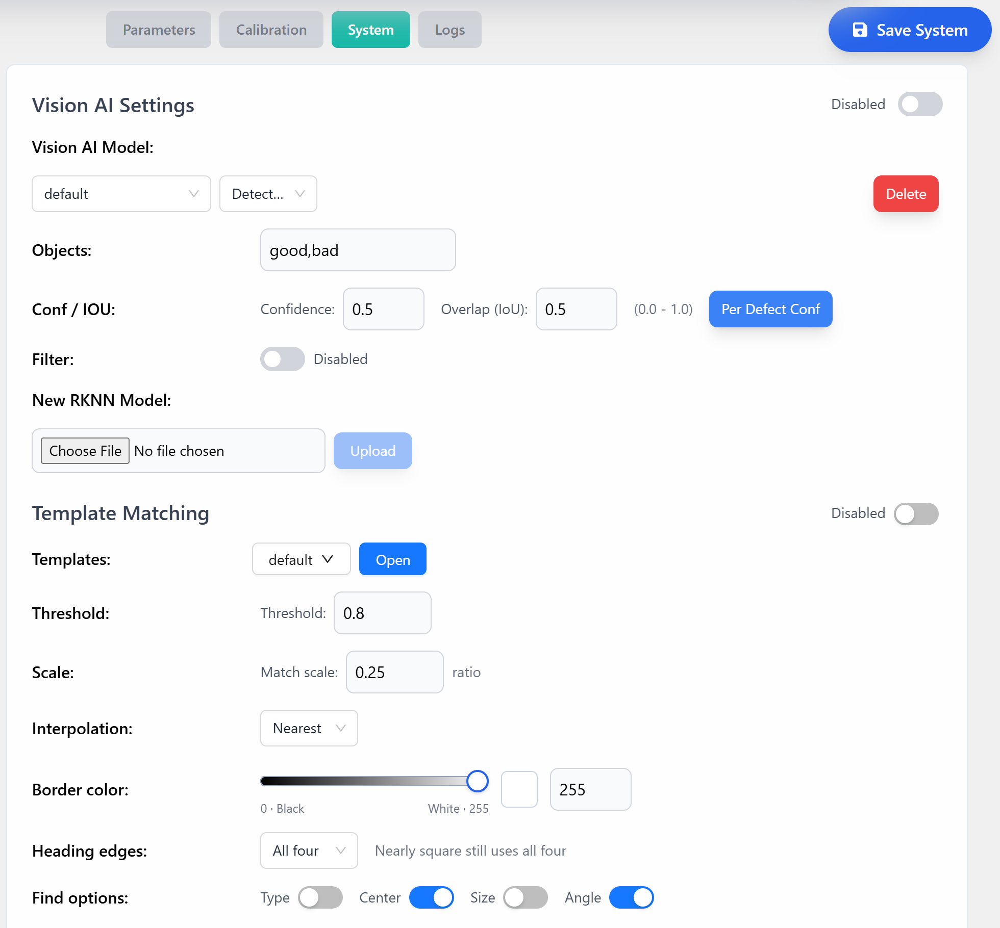
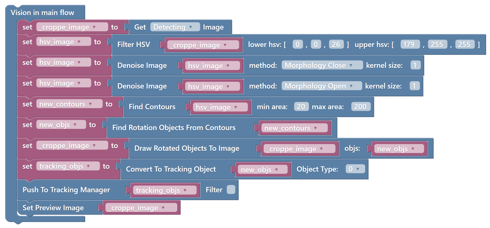

# Vision — Color filtering

Vision · Color filtering

[Change method](../vision.md)

Separate objects by color → find contours → send the final objects to tracking. No AI training is required.

Before starting: complete [Calibration](../calibration.md), check the live camera and lighting, and keep robot movement stopped. The object color must be distinguishable from the background.

New to the editor? See [Blockly](../blockly.md) for creating, checking, saving, and running a task. The pipeline for this detection method is described below.

## Prepare the color-detection task

Disable Vision AI and the System Template Matching switch. Save and apply the settings. Stop any previous vision task before running its replacement.

<figure class="studio-figure" markdown="1">

<figcaption>Keep both system switches Disabled. This workflow performs detection in Blockly.</figcaption>
</figure>

Open Programs and create a Blockly task with Vision in main flow.

## Build the vision pipeline

Pass each result to the next block. See the [Blockly program example](../blockly/color-filtering.md) for the block connections and test procedure.

<figure class="studio-figure block-detail" markdown="1">

<figcaption>Follow these block connections and choose filter values for your objects. The values in the pictured draft are examples.</figcaption>
</figure>

| Order | Block | Purpose |
| --- | --- | --- |
| 1 | Get Detecting Image | Read the calibrated detection image. |
| 2 | Filter HSV | Keep pixels within the object's color range. |
| 3 | Denoise Image | Use morphology close/open as needed to fill small gaps and remove noise. |
| 4 | Find Contours | Keep contours whose bounding-rectangle dimensions fall within the configured limits. |
| 5 | Find Rotation Objects From Contours | Obtain candidate centers, sizes, and angles. |
| 6 | Draw Rotated Objects To Image | Draw the candidates on the original detection image. |
| 7 | Convert To Tracking Object | Convert the candidates for the tracking system. |
| 8 | Push To Tracking Manager | Make accepted objects available to the picking task. |
| 9 | Set Preview Image | Display the annotated image for inspection. |

For white objects, the reference example uses lower HSV `[0,0,160]` and upper HSV `[179,40,255]`. Adjust these values to your lighting and material. The Find Contours fields are labeled Min area and Max area, but the current implementation compares both dimensions of the contour's rotated bounding rectangle against these limits, in pixels. Set them for the object size at the current camera scale.

Check the program, save it, and run the vision-only task for the intended robot from Saved Tasks. Inspect the mask by temporarily using it as the preview: objects should be separated cleanly from the background, without being split into several regions or joined to their neighbors. Then restore the annotated object preview and verify one detection per object.

## Verify detection before picking

Keep movement tasks stopped while checking the camera preview:

- Each class is detected at the positions, rotations, spacing, and partial occlusion expected during operation.
- Each object has one stable detection with the correct center, orientation, and class index.
- The empty background produces no false detections.

Once detection is reliable, continue to [Pick & Place](../pick_and_place.md#4-choose-how-to-run-the-system) and start with one object at a low test speed.

For a custom movement loop, follow [Color filtering + pick & place](../blockly/color-pick-and-place.md). It combines the tested HSV pipeline and picking blocks in one saved task, with Vision AI disabled.

## If detection does not work

| Problem | What to check |
| --- | --- |
| Background detected as objects | HSV mask, lighting, color bounds, and contour size limits. |
| Multiple candidates for one object | Mask gaps, morphology, and contour limits. |
| Preview works but picking sees no objects | Final object list connected to Convert To Tracking Object and Push To Tracking Manager. |
