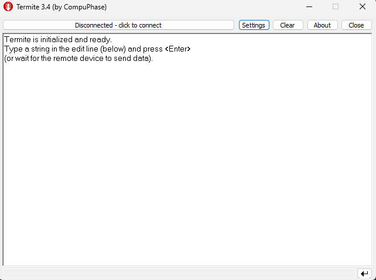
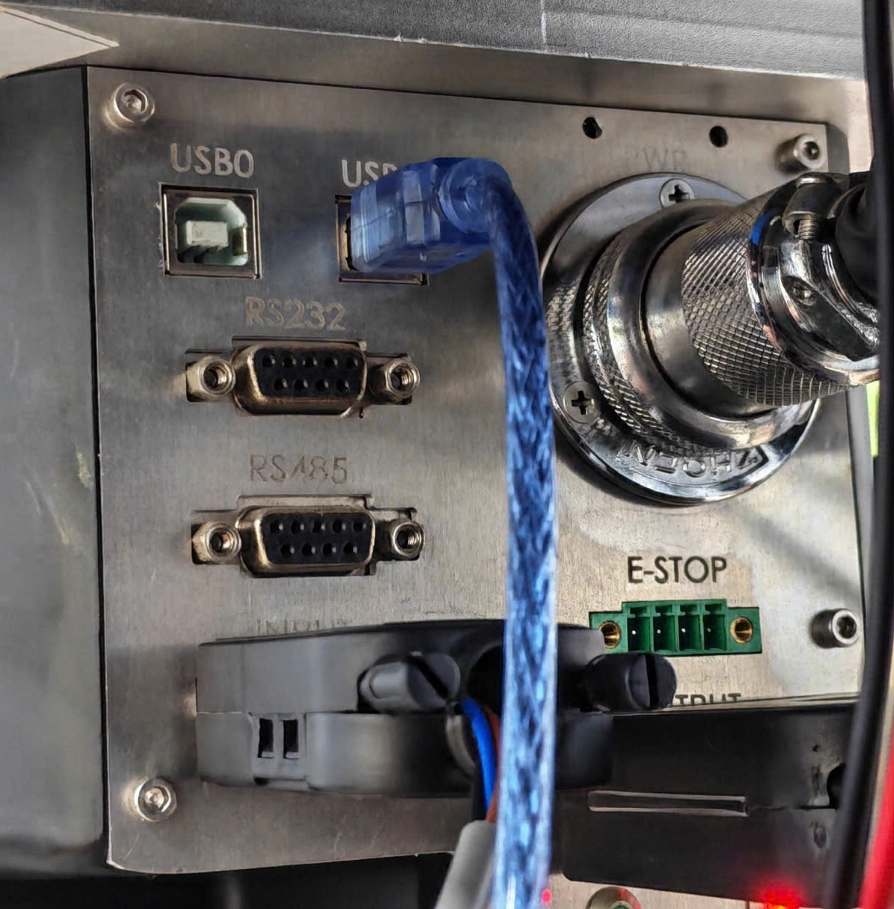
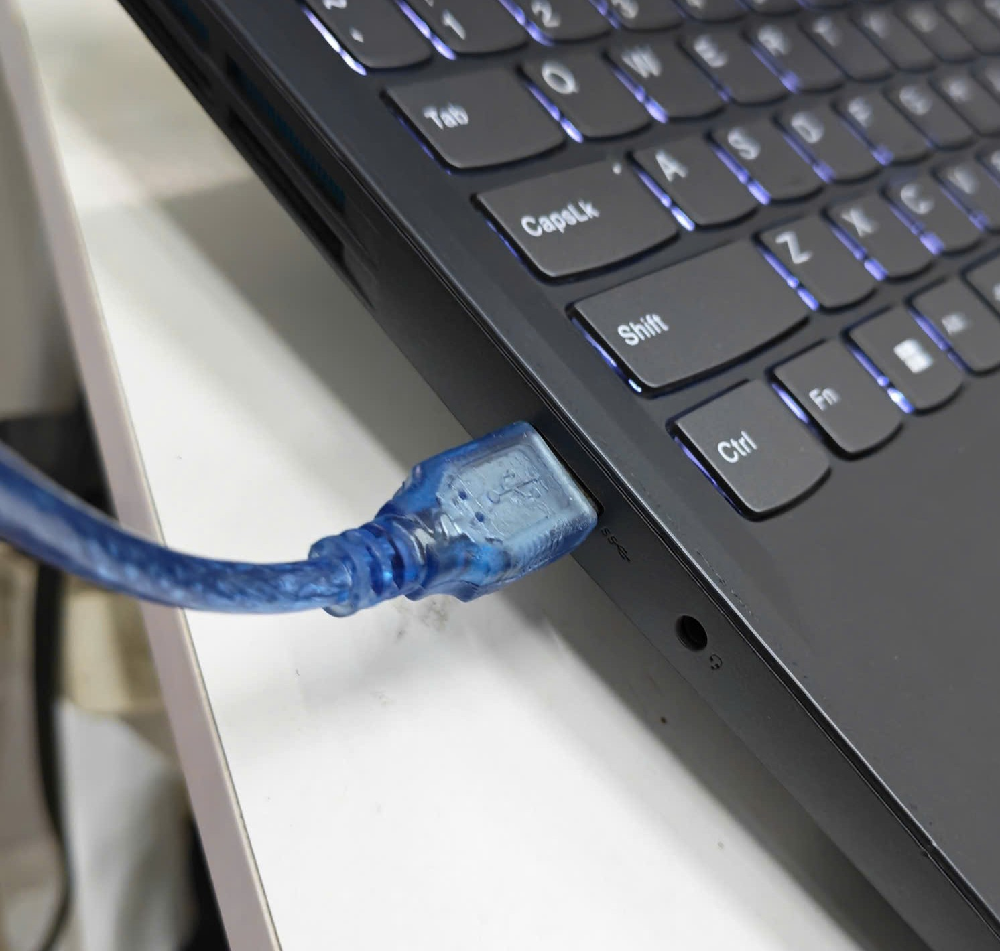
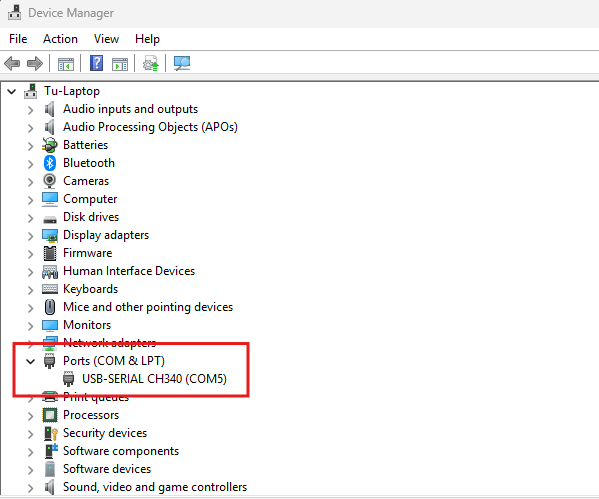
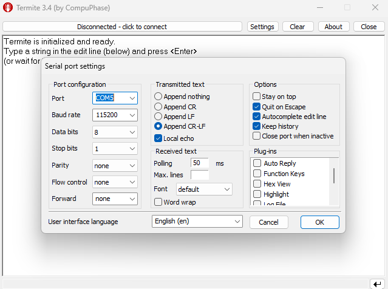
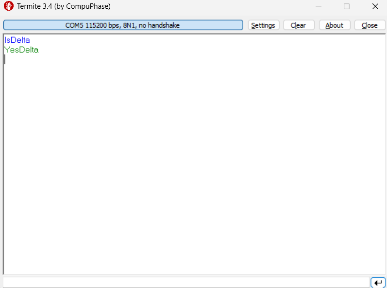
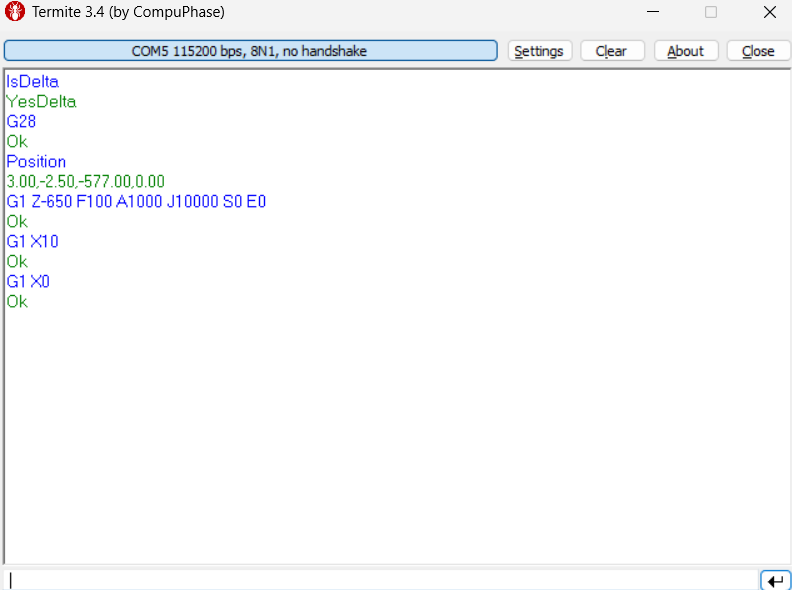

# Control Delta X 3 and Delta X S with Termite

Use Termite on Windows to send text commands to your robot through its USB serial connection. This guide takes you from selecting the COM port to homing and a short movement test.

## Before you start

Prepare an assembled, securely mounted robot, its power supply, a USB data cable, and a Windows computer. Clear the robot's working area before homing or moving it, and keep its physical emergency-stop control accessible.

Choose the command reference that matches your robot:

| Robot | G-code reference |
| --- | --- |
| Delta X 3, firmware < 2.0.0 | [X3 G-code](../../reference/gcodes/gc_x3.md) |
| Delta X 3, firmware > 2.0.0 | [New firmware reference — being prepared](../../reference/gcodes/gc_x3_v2.md) |
| Delta X S V4 | [XS V4 G-code](../../reference/gcodes/gc_xs_v4.md) |
| Delta X S V5 | [XS V5 G-code](../../reference/gcodes/gc_xs_v5.md) |

The command examples below follow the existing X3 reference and the XS V4/V5 references. For the new X3 firmware, use the commands provided with that firmware until its reference is available.

## 1. Open Termite

Download Termite from the [official CompuPhase download page](https://www.compuphase.com/software_termite.htm), install or extract it, and open the application.



The large area displays communication with the robot. Type commands in the narrow entry field at the bottom and press **Enter** to send them.

## 2. Connect the robot and find its COM port

1. Connect the robot's USB control port to the computer with the USB data cable.

    <div class="usb-photos" markdown="1">
    <figure markdown="1">

    

    <figcaption>Robot USB port</figcaption>
    </figure>
    <figure markdown="1">

    

    <figcaption>Computer USB port</figcaption>
    </figure>
    </div>

2. Turn on the robot's power supply. USB communication alone does not supply power for robot movement.
3. Close other applications using the robot's serial port, such as another terminal or control application.
4. Open Windows **Device Manager**, then expand **Ports (COM & LPT)**. Note the robot's COM number. You can unplug and reconnect the USB cable to identify the entry that disappears and returns.



This screenshot shows **USB-SERIAL CH340 (COM5)**. The device name and COM number may differ on your computer; use the port identified for your robot.

## 3. Configure the serial connection

Click **Settings** and use these values:

| Setting | Value |
| --- | --- |
| Port | The robot's COM port from Device Manager |
| Baud rate | `115200` |
| Data bits | `8` |
| Stop bits | `1` |
| Parity | `none` |
| Flow control | `none` |
| Forward | `none` |
| Transmitted text | **Append CR-LF** |
| Local echo | Checked, to display the commands you send |



**COM5 is the example port shown in these screenshots.** Select the port assigned to your robot in Device Manager. Click **OK**. If the status still reads **Disconnected - click to connect**, click that status field to open the port.

## 4. Check communication

Enter the following command in the bottom field and press **Enter**:

```text
IsDelta
```

The robot should reply with `YesDelta`. With local echo enabled, your typed command also appears in the receive area; that echoed line alone does not confirm a connection.

<div class="termite-screenshot" markdown="1">



</div>

Then send:

```text
Infor
```

Check the returned robot model and firmware version against the reference selected above.

## 5. Home the robot

Make sure the robot can complete its homing movement, then send:

```gcode
G28
```

Wait for homing to finish and for the completion reply, normally `Ok`, before sending a movement command. If the robot reports an error, resolve it before continuing.

Read the current position with:

```text
Position
```

The response format depends on the robot. X3 returns comma-separated XYZ coordinates; see [Useful Commands](../../reference/gcodes/useful_commands.md#get-current-position-command) for the model-specific formats.

## 6. Try a small movement

Use absolute positioning to move the tool to specific coordinates. In this mode, `X`, `Y`, and `Z` are target positions in the robot's current coordinate system, measured in millimeters.

**Send one line at a time and wait for `Ok` before the next line.** Do not paste the entire sequence into the command field at once.

After completing homing in step 5, select absolute positioning:

```gcode
G90
```

`G90` selects the coordinate mode; it does not move the robot.

### Move to a starting position

Choose **one** starting command for your robot. The examples use `Z-360` for X3 and `Z-750` from the XS G-code reference. For XS, check the workspace of your specific size and adjust Z before sending the command; `Z-750` is not a common working height for every XS model. Confirm that the path to the starting position and the following 10 mm X movement are clear. If you have configured coordinate offsets, account for them when choosing the target.

**Delta X 3:** move to the absolute position `(0, 0, -360)`:

```gcode
G01 X0 Y0 Z-360 F100 A1000 J10000 S0 E0
```

**Delta X S:** move to the absolute position `(0, 0, -750)`, using a Z value appropriate to your model:

```gcode
G01 X0 Y0 Z-750 F100 A1000 J10000 S0 E0
```

The starting command sets the feed rate to 100 mm/s, acceleration to 1000 mm/s², jerk to 10000 mm/s³, and start/end velocities to zero. These motion settings remain in effect for subsequent moves until changed; you only need to enter them once.

### Move along X and return

For either robot, send:

```gcode
G01 X10
```

This moves to the absolute coordinate `X = 10 mm`, keeping Y and Z at the starting values. Sending `G01 X10` again keeps the same target; it does not add another 10 mm.

Return to `X = 0 mm`:

```gcode
G01 X0
```

The tool is now back at the starting position you selected above, with the same Y and Z. Absolute positioning remains active for the next movement commands.

<div class="termite-screenshot" markdown="1">



</div>

The screenshot shows a test using `Z-650` for that setup, followed by `G1 X10` and `G1 X0`. Choose Z for your own robot as described above. `G90` is not shown in the screenshot; send it before the movement commands to select absolute positioning.

<span class="legacy-anchor" id="7-stop-and-disconnect"></span>

## 7. Emergency stop and recovery

Use `Emergency:Stop` when you need to interrupt robot movement because of an emergency. Enter the command in Termite and press **Enter** immediately; do not wait for the current movement's `Ok` reply.

```text
Emergency:Stop
```

The firmware replies `Delta:Stop`. Check that the robot has stopped, and stop sending movement commands. A serial emergency stop depends on the USB connection and firmware; use the physical emergency stop when immediate intervention is needed.

Write these commands exactly as shown, with no space after the colon.

<div class="command-reference-table" markdown="1">

| Command | Purpose |
| --- | --- |
| `Emergency:Stop` | Request an emergency stop and interrupt movement. |
| `Emergency:Resume` | Clear the software stop/pause condition so commands can run again. It does not restart the interrupted path from the stopping point. |
| `Emergency:Pause` | Request a pause. On the X3 and XS firmware covered by this guide, this also interrupts the active path; it is not a pause-and-continue function for that path. |
| `Emergency:Reset` | Restart the robot controller. Use it when a controller restart is required, then reconnect and home again. |

</div>

### Recover after an emergency stop

1. Identify and resolve the cause of the stop. Check the tool, workpiece, and robot's position, then clear the working area.
2. If the physical emergency-stop button was pressed, release it only after the cause has been resolved. A serial Resume command does not release the physical button.
3. Confirm that no unwanted commands are waiting to run. The examples in this guide send one movement at a time. If you previously sent several movements ahead, follow [Clear pending commands](#clear-pending-commands) before resuming.
4. Send:

    <pre><code class="language-text">Emergency:Resume</code></pre>

    XS replies `Delta:Resume`; X3 uses its configured completion reply, normally `Ok`. Resume allows commands to run again; it does not confirm the robot's position or home it.

5. Check that the homing path is clear, then send:

    <pre><code class="language-gcode">G28</code></pre>

    Wait for homing to finish before sending the next command. Re-homing is especially necessary if the stop interrupted homing, the motors were disabled, or the mechanism was moved.

6. Restore absolute positioning and check the position, sending each line separately:

    <pre><code class="language-gcode">G90</code></pre>

    <pre><code class="language-text">Position</code></pre>

7. Review the next target and motion settings, then send a new movement command when ready. Do not assume the interrupted move reached its original target.

### Clear pending commands

`Emergency:Stop` does not guarantee that queued commands have been cleared. Resume may allow pending commands to execute.

On **XS V5**, after the robot has stopped and before Resume, you can discard pending G-code commands with:

```text
Robot:QueueClear
```

This clears waiting commands; it does not stop an active movement. It is not available in the X3 or XS V4 firmware covered here.

For **X3 or XS V4**, if you are unsure which commands remain queued, use the controller restart procedure below instead of resuming that queue.

### Pause and resume

To request a pause, send:

```text
Emergency:Pause
```

The firmware replies `Delta:Pause`. Before sending `Emergency:Resume`, review the robot state and any pending commands as described above. Send a new target for the next movement; Resume does not complete the interrupted path automatically.

### Restart the controller

When a controller restart is required, first stop movement and stop sending commands, then send:

```text
Emergency:Reset
```

The firmware replies `Delta:Reset` and restarts. The USB connection may disconnect; wait for the controller to restart, then reconnect Termite if needed. Send `IsDelta` to check communication, run `G28` after checking the homing path, and select `G90` before using the absolute movement examples again. Re-enter any settings that were not saved before the restart.

## 8. Disconnect normally

Let the current movement finish, then click Termite's connection status field to close the COM port, or close Termite. You do not need `Emergency:Stop` just to disconnect after normal operation. **Closing the terminal does not stop a movement already executing.**

## Troubleshooting

| Symptom | What to check |
| --- | --- |
| The robot does not appear in Device Manager | Check power, the USB data cable, and the USB port. If Windows reports a driver issue, install the driver appropriate to the robot's USB interface. |
| Termite cannot open the COM port | Select the correct port and close any other application using it. |
| The sent command appears, but there is no robot reply | Check that the port is connected, the baud rate is `115200`, and **Append CR-LF** is selected. Local echo is not a reply from the robot. |
| The received text is unreadable | Check the baud rate, data bits, parity, and stop bits against the settings above. |
| `IsDelta` works but the robot will not move | Check motor power and the stop state. If stopped, follow [Emergency stop and recovery](#7-emergency-stop-and-recovery), then home with `G28` and read any returned error. |
| A movement command is rejected | Check the command reference for the installed firmware, the current G90/G91 mode, and the robot's workspace. |

For further commands, use the matching [X3 reference](../../reference/gcodes/gc_x3.md), [XS V4 reference](../../reference/gcodes/gc_xs_v4.md), or [XS V5 reference](../../reference/gcodes/gc_xs_v5.md).
